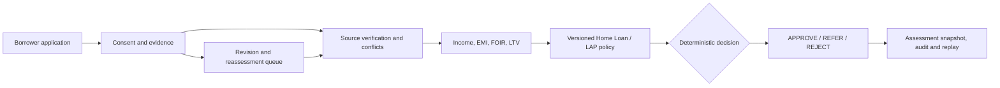

# Aadharshila

Aadharshila evaluates mortgage applications against evidence, affordability constraints, and versioned credit policies.

The backend uses Python 3.11+, FastAPI, Pydantic v2, SQLAlchemy 2, and Alembic. PostgreSQL 16 backs the Docker development stack; SQLite supports single-machine development. A bundled HTML/CSS/JavaScript client calls the API directly, while a database-backed worker handles queued reassessments.

## Architecture / Core Concepts

### Assessment pipeline



An application stores its product, applicant category, requested loan terms, property details, workflow status, ownership, and evidence revision. The service builds an assessment from the latest permissible evidence and the active policy belonging to the same lender organization. It persists the input snapshot, executed rules, calculation results, reason codes, policy version, and engine version. A later change creates a new assessment; historical decisions remain available for comparison and replay.

**Decision precedence:** confirmed policy failure produces `REJECT`; missing, expired, conflicting, or otherwise unresolved mandatory information produces `REFER`; `APPROVE` is returned only when every applicable gate passes. These outcomes describe the demonstration policy engine. They are not binding lender sanctions, and configured simulation data cannot satisfy live-production verification requirements.

| Area | Implementation | Boundary |
| --- | --- | --- |
| Products | Separate Home Loan and Loan Against Property policy packs | Thresholds are demonstration assumptions, not lender or universal RBI rules |
| Affordability | Decimal-based EMI, FOIR, LTV, monthly surplus, maximum eligible principal, total interest and repayment | Co-applicant income is not automatically added to accepted income |
| Income | Transaction normalization, reversal handling, duplicate suppression, own-account transfer exclusion, coverage and volatility checks | Analyst-submitted reconciliation is a preview; only authenticated source evidence can affect underwriting |
| Evidence | Consent, provider mode, source call provenance, freshness, revisions, contradictions and follow-up requests | A `SIMULATED` source is never a real issuer or bureau verification |
| Documents | Bounded PDF/TXT uploads, optional OCR, malware-scanner gate, AES-256-GCM encrypted local storage, isolated PDF parser process | OCR does not prove authenticity; parser isolation is not a hardened container sandbox |
| Identity | Role and organization checks, borrower object-level access, CSRF, OIDC authorization-code/PKCE and MFA-claim checks | Production SSO needs a lender IdP and pre-provisioned users |
| Governance | Lender-scoped policy versions, independent simulation and approval, recorded reasons, audit history | External legal, credit and compliance sign-off remains separate |
| Risk research | Deterministic synthetic dataset generation, logistic-regression training, chronological evaluation and input-drift diagnostics | Research output is not activated as a production probability-of-default model |
| Recovery | SQLite ciphertext-aware archives; Docker PostgreSQL and document-volume restore drill | CI recovery is not an institutional disaster-recovery certification |

### Repository layout

```text
AadharShila/
├── src/aadharshila/
│   ├── main.py                   # FastAPI routes, request validation and role checks
│   ├── models.py                 # Lender, application, evidence, policy and audit entities
│   ├── service.py                # Assessment snapshots, revisions and historical replay
│   ├── engine.py                 # Deterministic decision and reason-code generation
│   ├── finance.py                # Decimal EMI, FOIR, LTV, offers and stress calculations
│   ├── income.py                 # Transaction normalization and income reconciliation
│   ├── connectors.py             # Consent-bound fixture and signed partner gateway adapters
│   ├── secure_documents.py       # AES-256-GCM storage and integrity checks
│   ├── document_isolation.py     # Bounded PDF extraction subprocess
│   ├── browser_sso.py            # OIDC authorization-code/PKCE login flow
│   ├── production_gate.py        # External release-attestation signature validation
│   ├── risk_training.py          # Offline logistic-regression research
│   ├── synthetic_risk_benchmark.py
│   ├── observability.py         # Request counters and latency aggregates
│   ├── recovery.py              # Development backup, verification and restore
│   └── worker.py                # Revision-aware reassessment jobs
├── web/                          # Bundled browser client and styles
├── policies/                     # Illustrative Home Loan and LAP JSON policies
├── migrations/versions/          # Alembic schema revisions
├── data/                         # Synthetic-data manifest and regulatory references
├── docs/                         # Architecture, security, model, operations and release notes
├── tests/                        # API, finance, tenant, document and security regressions
├── scripts/                      # Browser, HTTP benchmark, backup and restore commands
│   └── windows/                  # Drive-independent PowerShell launchers
├── infra/                        # Production-style Compose illustration (not an approved deployment)
├── docker-compose.yml            # Local PostgreSQL + API + worker
├── .env.example                  # Configuration template
└── setup.bat / run.bat / worker.bat / test.bat
```

The system is a modular monolith. It uses database records for application and evidence history, and a separate worker for asynchronous reassessment. Policy simulations do not overwrite decisions already recorded. Access control is enforced in the API and data queries; hiding a navigation item in the browser is not treated as authorization.

## Prerequisites & Quickstart

- Python **3.11+**; Git; and internet access for the first dependency installation. The GitHub test matrix uses Python **3.12** on Windows and Ubuntu.
- Optional: Docker Desktop/Engine with Compose for the PostgreSQL development stack; Node.js for the JavaScript syntax check; Playwright/Chromium for browser tests.
- Optional research and document dependencies are installed separately. Tesseract, PDFium and a reachable ClamAV daemon are not included in the base install.

### Windows: local development on `D:`

The setup scripts resolve their own directory. Virtual environments, SQLite data and uploaded files remain under the selected project folder; no `C:` drive path is hard-coded.

```bat
mkdir D:\Projects
cd /d D:\Projects
git clone https://github.com/pushkkal0201-bit/AadharShila.git
cd AadharShila

:: Choose an installed interpreter; 3.12 is CI-tested, 3.11 is supported.
py -3.11 -m venv .venv
setup.bat
run.bat
```

For an existing checkout, run `git pull --ff-only origin main` from the project folder before `setup.bat`. Keep the server terminal open. In a second terminal, run `worker.bat` to process queued reassessments; `test.bat` runs the test suite. If a `.venv` already exists, inspect `.venv\Scripts\python.exe --version` before replacing it.

### Linux / macOS: local development

```bash
git clone https://github.com/pushkkal0201-bit/AadharShila.git
cd AadharShila
python3 -m venv .venv
source .venv/bin/activate
python -m pip install -r requirements.txt
python -m pip install --no-deps -e .
export APP_ENV=development SEED_DEMO=true
export DATABASE_URL=sqlite:///./aadharshila.db
python -m alembic upgrade head
python -m uvicorn aadharshila.main:app --host 127.0.0.1 --port 8000
```

In a separate shell, activate the same virtual environment and run `python -m aadharshila.worker` if you need queued jobs.

### Docker: PostgreSQL development stack

```bash
cp .env.example .env
# Edit .env; generate and set a unique SESSION_SECRET before starting.
docker compose up --build -d --wait
docker compose ps
docker compose logs -f api worker
```

The Compose file starts PostgreSQL 16, the API and a worker; the API applies Alembic migrations before serving requests. The database and documents use Docker-managed volumes, which are **not** automatically stored under your Windows project directory. Use `docker compose down` to stop services without removing those volumes. Never use `docker compose down -v` against data you intend to retain.

### First-run endpoints

| Address | Purpose |
| --- | --- |
| `http://127.0.0.1:8000/` | Underwriting workspace |
| `http://127.0.0.1:8000/docs` | Interactive OpenAPI documentation |
| `http://127.0.0.1:8000/health/live` | Process liveness |
| `http://127.0.0.1:8000/health/ready` | Database readiness |

```bash
curl -sS http://127.0.0.1:8000/health/ready
# {"status":"READY","database":"connected"}
```

With `APP_ENV=development` and `SEED_DEMO=true`, first startup seeds **16 synthetic applications** and the following local accounts, all with password `Demo@12345`: `borrower`, `analyst`, `compliance`, `policy_author`, `policy_approver`, `auditor`, and `admin`. They are for local tests only. Password login and demo seeding are disabled in production mode.

## Usage Examples

### 1. Review an application through the HTTP API

From a Bash-compatible shell, with the local demo server running:

```bash
BASE=http://127.0.0.1:8000

curl -sS -c cookies.txt \
  -H 'Content-Type: application/json' \
  -d '{"username":"analyst","password":"Demo@12345"}' \
  "$BASE/api/v1/auth/login" > login.json

curl -sS -b cookies.txt "$BASE/api/v1/applications?limit=50" > applications.json

APP_ID=$(python -c 'import json; a=json.load(open("applications.json")); print(next(x["id"] for x in a["items"] if x["reference"]=="AS-1004"))')
CSRF=$(python -c 'import json; print(json.load(open("login.json"))["csrf"])')

curl -sS -b cookies.txt \
  -H "X-CSRF-Token: $CSRF" \
  -X POST "$BASE/api/v1/applications/$APP_ID/assessments" > assessment.json

python -c 'import json; x=json.load(open("assessment.json")); print(x["outcome"]); print([r["code"] for r in x["result"]["reasons"]])'
```

Expected outcome for the unmodified synthetic `AS-1004` case (abbreviated):

```text
REFER
['INCOME_CONTRADICTION']
```

`AS-1004` is a self-employed LAP application with conflicting income sources. The engine can report every evidence item as verified **within the fixture** and still refer the case because the amounts disagree. `AS-1003` demonstrates affordability failure; `AS-1007` demonstrates a provider-failure referral.

For the saved assessment, the following endpoints expose the decision, explanation, evidence pack and replay. Replace `<assessment-id>` with the `id` field in `assessment.json`:

```text
GET  /api/v1/assessments/<assessment-id>/decision
GET  /api/v1/assessments/<assessment-id>/explanation
GET  /api/v1/assessments/<assessment-id>/evidence-pack
POST /api/v1/assessments/<assessment-id>/replay
GET  /api/v1/applications/<application-id>/assessment-diff
```

Replays use stored inputs and policy versions; they do not query a current external provider or rewrite the original decision.

### 2. Reconcile transactions without changing an approved evidence record

`POST /api/v1/applications/{id}/income-reconciliation` accepts a `TransactionBatch` and produces an analyst preview. The normalizer checks recurring income, own-account transfers, loan proceeds, reversals, duplicate receipts, observation coverage, volatility and obligations. The API returns `assessment_effect: "NONE"`. A preview cannot be promoted into verified bank evidence without the authenticated provider route and consent checks.

Related analyst routes:

```text
GET  /api/v1/applications/<id>/evidence
GET  /api/v1/applications/<id>/conflicts
GET  /api/v1/applications/<id>/next-evidence
POST /api/v1/applications/<id>/providers/<evidence-key>/run
POST /api/v1/applications/<id>/property-review-preview
GET  /api/v1/applications/<id>/sanction-preview
```

The sanction endpoint returns a **non-binding preview**. It does not issue a legally effective sanction, generate a lender-approved KFS, or initiate a disbursement.

### 3. Govern policy changes without rewriting previous assessments

A policy author creates and validates a lender-scoped draft. An authorized analyst or policy staff member runs a portfolio simulation, which stores the input policy's SHA-256 fingerprint and changed-outcome counts. A separate policy approver supplies a recorded justification to approve and activate the validated version. Approval fails if the policy has changed since its relevant simulation, if the same person performs conflicting steps, or if lender scope does not match.

```text
POST /api/v1/policies
POST /api/v1/policies/<id>/validate
POST /api/v1/policies/<id>/simulate
POST /api/v1/policies/<id>/approve       {"reason":"Reviewed simulation and signed-off credit committee record"}
POST /api/v1/policies/<id>/activate      {"reason":"Approved controlled policy release after committee review"}
GET  /api/v1/policies/<id>/simulations
GET  /api/v1/operations/governance-audit
```

These are **internal workflow controls**. A lender-owned policy, qualified legal review and institutional release attestations are still required before automated lending decisions can be authorized.

### 4. Run reproducible credit-risk research

Install the optional research requirements, then produce a fixed-seed dataset and offline holdout evaluation:

```bash
python -m pip install -r requirements-ml.txt
python -m aadharshila.synthetic_risk_benchmark --output-dir .risk-ci --seed 42 --rows 640
```

Representative output fields:

```json
{
  "status": "SYNTHETIC_TEST_ONLY",
  "seed": 42,
  "rows": 640,
  "model_activated": false,
  "holdout_test": { "roc_auc": 0.685803 }
}
```

The displayed ROC AUC is a previously recorded synthetic-generator run, **not an estimate of real mortgage-default prediction quality**. The full output includes other holdout metrics and limitations; the research model is never loaded into live assessments. The offline pipeline rejects unknown label horizons, duplicate borrower IDs, incomplete source manifests and immature real-outcome labels.

### 5. Run browser, API and recovery checks

```bash
python -m pytest -q
node --check web/app.js

python -m pip install -r requirements-browser.txt
python -m playwright install chromium
python scripts/browser_smoke.py

python scripts/http_benchmark.py --requests 60 --concurrency 6
```

The HTTP benchmark authenticates to a newly started local synthetic-data API and reports request count, failures, p50/p95/p99 latency, process environment and workload. It is a bounded development smoke, not a production throughput or latency guarantee.

Docker PostgreSQL and document recovery drill:

```bash
bash scripts/docker_backup.sh ./backup-dev
bash scripts/docker_restore_drill.sh ./backup-dev
```

The restore script verifies the recovered database and corresponding document bytes in a disposable recovery database. Backups of encryption keys are separate; never include private key material in Git or a public application archive. The CI workflow repeats Windows/Ubuntu tests, a Chromium smoke, and a Docker/PostgreSQL recovery exercise.

## Configuration / Environment Variables

`.env.example` is the development template. Treat secrets, identity-provider registration, lender release attestations and provider credentials as external deployment dependencies. The table distinguishes application defaults from settings included in the Docker development template.

| Variable | Type | Default / requirement | Description |
| --- | --- | --- | --- |
| `APP_ENV` | `development` / `production` | `development` | Enables production safety restrictions, including rejection of SQLite and local password login. |
| `DATABASE_URL` | SQLAlchemy URL | `sqlite:///./aadharshila.db`; Docker example uses PostgreSQL | Database connection; production requires externally managed PostgreSQL. |
| `SEED_DEMO` | Boolean string | `true` in development | Inserts deterministic synthetic cases on initial startup. Must be `false` in production. |
| `SESSION_SECRET` | String | Development-only placeholder | Signs local sessions and OIDC flow state; production requires a unique secret of at least 32 characters. |
| `UPLOAD_DIR` | Filesystem path | `var/documents` | Local document bytes; application-relative on Windows, container-mounted in Docker. |
| `AADHARSHILA_DOCUMENT_KEYS_PATH` | File path | Unset | External JSON keyring mapping key IDs to base64-encoded 32-byte AES keys. Required for production uploads. |
| `AADHARSHILA_DOCUMENT_ACTIVE_KEY_ID` | String | Unset | Key ID used for **new** AES-256-GCM document uploads; old keys remain necessary for older ciphertext. |
| `ENABLE_DOCUMENT_OCR` | Boolean string | `false` | Enables optional scanned-PDF OCR when the runtime dependencies are installed. |
| `CLAMAV_UNIX_SOCKET` | Unix socket path | Unset | Scanner endpoint; production uploads fail closed when scanning cannot be completed. |
| `OIDC_ISSUER` | HTTPS URL | Unset | Pinned identity-provider issuer. |
| `OIDC_AUDIENCE` | String | Unset | Accepted API audience for signed federated identity tokens. |
| `OIDC_JWKS_PATH` | File path | Unset | Institution-managed public signing keys; no automatic role creation from token claims. |
| `OIDC_REQUIRE_MFA` | Boolean string | `true` | Enforces MFA-related assertions during federated-token validation. |
| `OIDC_REQUIRED_ACR` | String | Unset | Optional required authentication-assurance claim. |
| `OIDC_AUTHORIZATION_ENDPOINT` | HTTPS URL | Unset | Fixed browser authorization-code endpoint at the configured issuer. |
| `OIDC_TOKEN_ENDPOINT` | HTTPS URL | Unset | Fixed authorization-code token exchange endpoint. |
| `OIDC_CLIENT_ID` | String | Unset | Registered browser SSO client identifier. |
| `OIDC_CLIENT_SECRET` | Secret | Unset | Registered SSO client credential; never commit it. |
| `OIDC_REDIRECT_URI` | URL | Unset | Registered callback ending in `/api/v1/auth/oidc/callback`; HTTPS in production. |
| `AADHARSHILA_PARTNER_ALLOWED_HOSTS` | Comma-separated hosts | Empty | Explicit HTTPS partner-gateway host allowlist. |
| `AADHARSHILA_PARTNER_<KEY>_URL` | HTTPS URL | Unset | Configured gateway for one supported evidence key, e.g. `BANK_INCOME`. |
| `AADHARSHILA_PARTNER_<KEY>_MODE` | `SANDBOX` / `LIVE` | `SANDBOX` when configured | Gateway mode; configured labels alone do not establish authorized source verification. |
| `AADHARSHILA_PARTNER_<KEY>_NAME` | String | Unset | Approved integration/provider name. |
| `AADHARSHILA_PARTNER_<KEY>_TOKEN` | Secret | Unset | Gateway request authentication. |
| `AADHARSHILA_PARTNER_<KEY>_HMAC_KEY` | Secret | Unset | Signed-response verification secret. |
| `AADHARSHILA_TRUST_STORE` | File path | Unset | Public keys and institutional roles for release attestations. |
| `AADHARSHILA_RELEASE_BUNDLE` | File path | Unset | Externally signed, lender/product/policy-scoped release attestations. |
| `METRICS_ACCESS_TOKEN` | Secret | Unset | When configured with at least 24 characters, protects `/internal/metrics` via `X-Metrics-Token`. |

`APP_ENV=production` and a configured gateway do **not** create the legal right to originate credit. The release verifier checks Ed25519 signatures, role separation, dates and policy scope; the institution must independently establish each signer's authority and the underlying approval. The real-data credit-risk model, official KYC/bureau integrations, binding sanctions and disbursement are **not operational components** of this repository. The deployment example at `infra/compose.production.example.yml` is a reference requiring lender-managed infrastructure, network policy, secrets, scanner services and security review.

## Contributing

Work against the current `main` branch. Keep policy values and synthetic fixture data distinguishable from statutory requirements or lender-authorized inputs.

```bash
git checkout main
git pull --ff-only origin main
git checkout -b fix/describe-change

python -m pip install -r requirements-ml.txt
python -m pip install --no-deps -e .
python -m pytest -q
node --check web/app.js
python -m alembic upgrade head
```

For changes to authentication, evidence handling, policy activation or document access, add a regression that exercises both the permitted path and the denied path. For changes to persisted entities, include an Alembic migration and test it against a fresh database and a backed-up upgrade candidate. Run the browser smoke for UI changes; run the PostgreSQL recovery drill for storage or deployment changes.

Open a pull request with the failure or requirement, affected endpoints and tables, migrations, tests executed, expected behavior and known limitations. Do not include borrower records, secrets, signed-provider credentials, unapproved policy figures or model artifacts trained on restricted data. See [`docs/ARCHITECTURE.md`](docs/ARCHITECTURE.md), [`docs/ENGINEERING_RELEASE_2026-11-10.md`](docs/ENGINEERING_RELEASE_2026-11-10.md), [`docs/PRODUCTION_READINESS.md`](docs/PRODUCTION_READINESS.md) and [`docs/INSTITUTIONAL_GO_LIVE.md`](docs/INSTITUTIONAL_GO_LIVE.md) for the corresponding engineering and release boundaries.