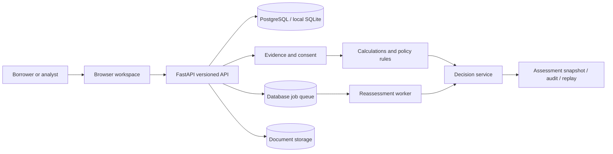

# Aadharshila

**Evidence-driven mortgage underwriting | Home Loans and Loan Against Property**

Aadharshila is an integrated lending-operations demonstrator. It converts an application and supporting evidence into an explainable **APPROVE**, **REJECT**, or **REFER** decision using explicit, versioned credit rules. Each assessment stores the exact input and policy used, so a reviewer can reproduce an earlier decision after later evidence changes.

Built for the **E-Cell IIT Bombay × Hero Housing Fintech Challenge — Problem Statement 2, Digitally Automated Mortgage Underwriting Engine**. This repository is an independent prototype. It is **not affiliated with or endorsed by Hero Housing Finance or UIDAI**, and it does not issue genuine loan sanctions.

## Why this exists

Mortgage assessments often depend on information spread across declarations, statements, income records, bureau results, identity checks and legal or property reviews. The difficult part is not calculating EMI. It is identifying which facts can be relied upon, reconciling conflicting evidence, and showing exactly why a case can proceed or needs another check.

Aadharshila separates **claimed information**, **evidence**, **verification status**, **affordability**, **credit rules** and **final routing**. Missing or conflicting prerequisites lead to a referral, rather than an approval assembled from incomplete information.

## What is implemented

| Capability | Behavior in this repository |
| --- | --- |
| Application intake | Create, edit, submit and inspect Home Loan or LAP cases; salaried/self-employed; optional co-applicant and guarantor relationships |
| Identity and role access | Password-hashed local demo users, signed HttpOnly sessions, mutation CSRF checks, organization and borrower data boundaries |
| Consent | Purpose-specific financial-underwriting consent; borrower-controlled grant/revocation; future collection gated in the evidence interface |
| Evidence | Separate provider, integration mode, verification, freshness, capture time and revision; simulated provider data is explicitly labeled |
| Document ingestion | Validated PDF/TXT upload, SHA-256, bounded text parsing and structured field extraction; no inferred issuer authenticity |
| Financial assessment | Decimal EMI, FOIR, LTV, monthly surplus, principal eligibility, total interest and repayment calculations |
| Policy management | Separate Home Loan/LAP thresholds, draft/validate/approve/activate lifecycle and role separation |
| Credit decision | Deterministic precedence: confirmed hard policy failure → REJECT; unresolved prerequisites/conflicts → REFER; all gates passed → APPROVE |
| Contradictions | Income mismatch, property valuation mismatch and identical document hashes reused in unrelated cases |
| Review requests | Missing evidence and conflicts become attributable tasks; closure cannot bypass mandatory rules |
| Scenario studio | Alternative principal/EMI and income, interest-rate and collateral stress calculations |
| History and replay | Stored immutable-in-application snapshots, previous decisions retained, deterministic no-provider replay |
| Operations | Audit records, basic current-decision counts, documented API, durable database reassessment jobs |
| Demo | 16 deterministic synthetic applications covering approval, referral, policy failure, outage, expiry, correction and attack cases |

**Important:** verification marked `SIMULATED` represents a deterministic, local fixture assertion. It is **not** a real bank, issuer, bureau or government verification. Thresholds in `policies/` are **illustrative assumptions**, not actual Hero Housing Finance credit rules or universal regulatory limits. The risk indicator is an explanatory rule band, **not a trained probability-of-default model**.

## Architecture



The runtime is a **modular monolith**. The interface is a lightweight HTML/CSS/JavaScript client served by FastAPI rather than a separate Next.js process. This is a deliberate local-delivery simplification: it is actually connected to the API, runs without npm dependencies, and avoids maintaining an untested second application server. A hosted deployment could replace the UI independently using the documented API contract.

Main source paths:

```text
src/aadharshila/
  main.py          API, auth, permissions, intake, review, document endpoints
  models.py        Relational entities and versioned records
  db.py            Database sessions and local persistence
  finance.py       Decimal loan calculations
  engine.py        Pure, deterministic policy assessment
  service.py       Evidence snapshots, revisions, decisions, replay
  security.py      Sessions and role checks
  worker.py        Durable reassessment processing
  seed.py          Synthetic fixtures
web/               Browser workspace
policies/          Versioned illustrative credit packs
migrations/        Alembic database migration
scripts/           Benchmark utilities
tests/             Unit and integration tests
scripts/windows/  Windows setup, run, worker and test commands
```

## Windows (including D: drive)

Extract or clone into `D:\Projects\Aadharshila` (or any other location). Double-click `setup.bat` once, followed by `run.bat`. Use `worker.bat` for background reassessments and `test.bat` to run verification. Scripts locate their own repository root, support spaces in the drive path, and keep the virtual environment and demo database on the selected drive. See [`docs/WINDOWS_D_DRIVE.md`](docs/WINDOWS_D_DRIVE.md).

## Run it locally

**Python 3.11 or later**. From the repository root:

```bash
python -m venv .venv
source .venv/bin/activate     # Windows: .venv\Scripts\activate
pip install -r requirements.txt
pip install --no-deps -e .
export DATABASE_URL=sqlite:///./aadharshila.db  # Windows PowerShell: $env:DATABASE_URL='sqlite:///./aadharshila.db'
alembic upgrade head
uvicorn aadharshila.main:app --reload
```

Open **http://127.0.0.1:8000** for the interface, **http://127.0.0.1:8000/docs** for OpenAPI, and **http://127.0.0.1:8000/health/ready** for readiness.

For the development demo, `SEED_DEMO=true` (default) inserts 16 synthetic cases at first launch. Once populated, startup does not duplicate them. No external credentials or provider accounts are required.

**With Docker Compose** (not exercised in the authoring environment):

```bash
cp .env.example .env
# Replace SESSION_SECRET in .env with a strong random value.
docker compose up --build -d
# Open http://localhost:8000
```

`docker-compose.yml` provides PostgreSQL, API and background worker. The API runs the Alembic migration first. In local SQLite development, the web application can operate without the worker; manually queued reassessments require `python -m aadharshila.worker` in another terminal.

### Demo accounts

Only available when `APP_ENV=development` and the database is seeded.

| Username | Password | Role |
| --- | --- | --- |
| `borrower` | `Demo@12345` | Own-case intake and consent |
| `analyst` | `Demo@12345` | Assessments, evidence review |
| `compliance` | `Demo@12345` | Compliance review |
| `policy_author` | `Demo@12345` | Draft and validate policy |
| `policy_approver` | `Demo@12345` | Independent approval and activation |
| `auditor` | `Demo@12345` | Read-only scoped history |
| `admin` | `Demo@12345` | Local administration |

These are **public development credentials**, never production accounts. Disable seeding and replace the authentication onboarding workflow before any shared deployment.

## Main demo flow

1. Log in as `analyst`; open `AS-1004` (self-employed LAP, contradictory income).
2. In **Evidence explorer**, inspect `bank_income` and `income_support` with their sources and modes. The current outcome is **REFER**.
3. In the evidence form, set `income_support` to `99000`, select `VERIFIED` and `SIMULATED`. This creates another evidence revision and runs the decision engine.
4. Open **Decision explanation** to inspect the changed result and executed rules. The original decision is retained.
5. Open **Historical replay** and replay the earlier assessment; it still reproduces its own **REFER** outcome.
6. Use **Offers & stress tests** to show explicitly calculated principal and stress variations.
7. Inspect `AS-1001` (clean Home Loan approval fixture), `AS-1003` (affordability rejection) and `AS-1007` (upstream failure referral).

Other scenarios: `AS-1006` ambiguous screening, `AS-1008` expired bank evidence, `AS-1009` property revision, and `AS-1013` shared-document detection. All demonstrations use the same assessment functions, not special-case outcome overrides.

## Testing and validation

```bash
PYTHONPATH=src pytest -q
node --check web/app.js
```

The local implementation test suite was run successfully (36 automated checks in the latest run) (see `docs/TEST_REPORT.md`). A programmatic HTTP smoke check reached the root, readiness endpoint, login and case detail. Direct automated Chromium navigation was blocked by the execution environment. Static Chromium visual rendering with injected live API case data succeeded without page errors, but it is **not** a successful browser-to-API E2E journey. Docker Compose was **not** run in this environment.

## Integration and regulatory boundaries

The connectors page lists identity, CKYCR, DigiLocker, Account Aggregator, bureau, GST/tax, registry, CERSAI, RERA, valuation and sanctions/PEP categories in **SIMULATED** mode. The consent-gated fixture adapter also records each local provider invocation with an explicit mode and correlation ID. No provider tokens are included. A provider outage is unresolved; source text extracted from an upload does not become trusted identity or financial evidence automatically.

Recent RBI sources are catalogued in `docs/REGULATORY_SOURCES.md` (including the RBI Housing Finance Companies Directions, 2025, updated October 2026). The code does **not** claim to have encoded or legally certified those directions. Some credit policy thresholds are illustrations only and remain separate from the cited regulatory sources.

## Documentation

- [`docs/WINDOWS_D_DRIVE.md`](docs/WINDOWS_D_DRIVE.md) — Windows and D: drive installation
- [`docs/ARCHITECTURE.md`](docs/ARCHITECTURE.md) — data flow, state models and module boundaries
- [`docs/DECISION_RULES.md`](docs/DECISION_RULES.md) — calculation and precedence specification
- [`docs/REGULATORY_SOURCES.md`](docs/REGULATORY_SOURCES.md) — official source register, pending control review
- [`docs/INTEGRATIONS.md`](docs/INTEGRATIONS.md) — integration contract and mode inventory
- [`docs/THREAT_MODEL.md`](docs/THREAT_MODEL.md) — security assumptions and residual risks
- [`docs/MODEL_CARD.md`](docs/MODEL_CARD.md) — scorecard provenance and limitations
- [`docs/TEST_REPORT.md`](docs/TEST_REPORT.md) — executed local validation and omissions
- [`docs/OPERATIONS.md`](docs/OPERATIONS.md) — startup, health, worker, backup and recovery
- [`docs/DEMO_SCRIPT.md`](docs/DEMO_SCRIPT.md) — five-to-seven-minute judge walkthrough
- [`docs/PRODUCTION_READINESS.md`](docs/PRODUCTION_READINESS.md) — verified, simulated and outstanding capabilities
- [`docs/traceability.json`](docs/traceability.json) — requirement-to-module status

## Important limitations

This is a substantial locally runnable integrated demonstrator, **not a production-ready loan origination system**. It requires lender-approved policies, licensed provider integrations, professional legal/title checks, production identity onboarding, security validation, retention controls, independent model assessment and deployment/recovery exercises before use with real borrowers. No real disbursements are implemented. No trained ML probability of default is asserted.

## Production-hardening additions (10 November 2026)

The code includes a **fail-closed production governance gate**: `APP_ENV=production` always routes local decisions to `REFER`. Simulated and sandbox evidence cannot satisfy production verification prerequisites, and a `LIVE` label alone never authorizes a lender decision. The product must not be presented as issuing real credit approval or rejection.

A fixed HTTPS **partner gateway adapter** now supports signed response validation, consent enforcement, bounded timeouts, correlation IDs, and fail-closed error reporting for an institution's separately authorized integration. **No real lender, credit-bureau, government, AA or KYC provider connection has been enabled.** See [`docs/PROVIDER_ONBOARDING.md`](docs/PROVIDER_ONBOARDING.md). Internal security regression tests and residual risks are tracked in [`docs/SECURITY_REVIEW.md`](docs/SECURITY_REVIEW.md).

The optional [`risk_training.py`](src/aadharshila/risk_training.py) module provides documented, reproducible offline logistic-regression development with temporal holdout evaluation, calibration reporting, dataset-provenance requirements and duplicate-borrower leakage checks. The research model is **never activated** by the underwriting service, and no real mortgage outcome dataset or independent validation is available. See [`docs/RISK_TRAINING.md`](docs/RISK_TRAINING.md).

A **portable SQLite backup and restore tool** includes document bytes, SHA-256 verification and a no-overwrite recovery path. Run `python -m aadharshila.recovery --help` or follow [`docs/RECOVERY_DRILL.md`](docs/RECOVERY_DRILL.md). The first local drill restored all 16 synthetic cases, and a separate automated test validated recovery of a synthetic document. Docker Compose PostgreSQL restore scripts and a CI execution job are included, but production PITR and cloud disaster recovery are outside the local build.

### What remains external

Before a genuine financial institution could use this platform for actual borrowers, its authorized staff and suppliers must provide: provider contracts and API credentials; legally valid borrower-consent terms; permitted data access; independently approved and calibrated model data; lender-adopted credit policies; a qualified third-party security review; contractual and regulatory counsel sign-off; and secure hosted deployment with backup/failover exercises. None can be genuinely self-certified by a software project. The local engineering build deliberately keeps these dependencies visible rather than issuing fictional approvals.

## Institutional release verification (10 November 2026)

`src/aadharshila/production_gate.py` checks independent Ed25519 attestations scoped to the exact active policy, lender organization and product. Production requires authenticated LIVE evidence linked to a successful provider invocation, not a standalone LIVE flag, and refuses SQLite. See [Institutional Go Live](docs/INSTITUTIONAL_GO_LIVE.md).

These safeguards do **not** establish licensing, provider contracts, independent legal review, real-world model accuracy or authorization to issue mortgages.
