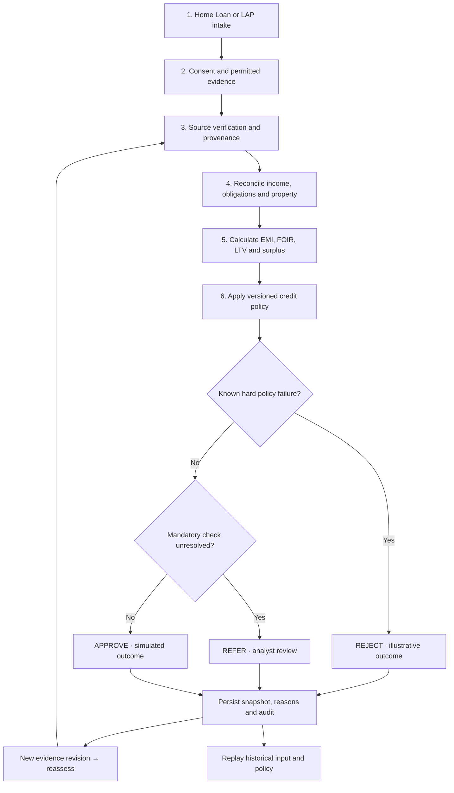
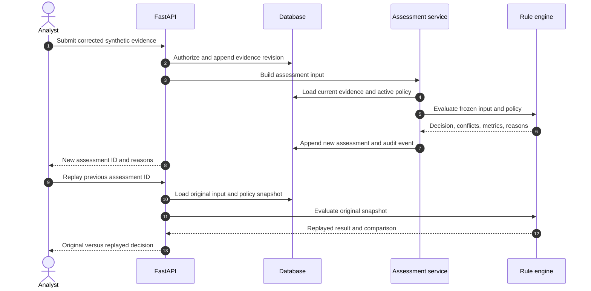
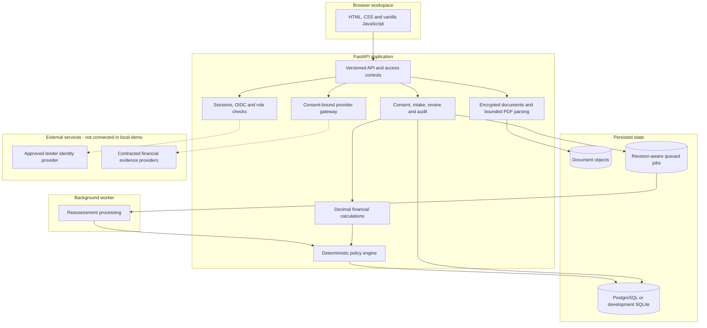
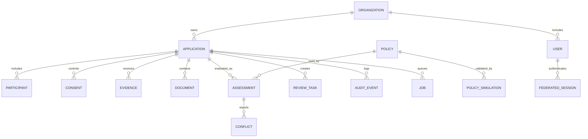
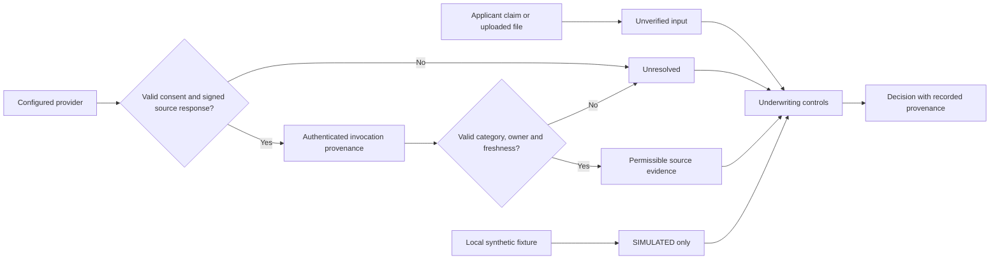
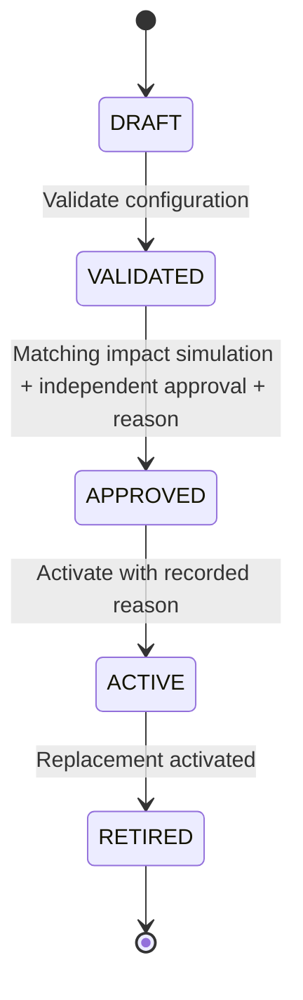
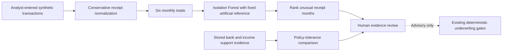

# Aadharshila

**An evidence-to-decision underwriting workspace for Home Loans and Loans Against Property.**

Aadharshila evaluates mortgage applications against consent-bound evidence, financial constraints, and versioned credit policies. It records the inputs behind each decision, explains unresolved conditions, and can reproduce a previous assessment after the application changes. The application is built with **Python, FastAPI, SQLAlchemy, PostgreSQL, and a browser-based JavaScript client**; the repository contains a runnable local demonstration with 16 synthetic loan cases.

[](https://github.com/pushkkal0201-bit/AadharShila/actions/workflows/quality.yml)
[](pyproject.toml)
[](src/aadharshila/main.py)
[](docker-compose.yml)
[](data/MANIFEST.md)

**[AI evidence review](#ai-assisted-evidence-review--live-hackathon-feature)** · **[ML risk laboratory](#full-ml-risk-model-laboratory--synthetic-research)** · **[Problem](#the-problem)** · **[Users](#who-uses-it-and-when)** · **[Live walkthrough](#six-minute-judge-walkthrough)** · **[Design](#what-makes-the-implementation-different)** · **[Workflow](#underwriting-workflow)** · **[Architecture](#system-architecture)** · **[Tech stack](#technology-stack)** · **[Run locally](#installation-and-local-setup)** · **[API](#api-usage)** · **[Verification](#testing-and-verification)** · **[Security](#security-trust-boundaries-and-production-scope)**

> [!IMPORTANT]
> **Local engineering demonstration, not a lending service.** The borrowers, financial records, provider assertions, and credit policies in this repository are synthetic or illustrative. `APPROVE`, `REFER`, and `REJECT` describe **demonstration underwriting decisions**. No live KYC, credit bureau, Account Aggregator, property-registry, lender-sanction, or disbursement service is connected. The offline ML research model is not used to approve loans.

---

## Choose a path

<table>
  <tr>
    <td width="33%" align="center"><a href="#six-minute-judge-walkthrough"><strong>▶ See the decision</strong></a><br/><sub>Six-minute judge walkthrough · AS-1004</sub></td>
    <td width="33%" align="center"><a href="#underwriting-workflow"><strong>◈ Follow the evidence</strong></a><br/><sub>Rules · provenance · revisions · replay</sub></td>
    <td width="34%" align="center"><a href="#installation-and-local-setup"><strong>⌘ Run the project</strong></a><br/><sub>Windows · Python · Docker · local demo</sub></td>
  </tr>
  <tr>
    <td align="center"><a href="#system-architecture"><strong>▣ Inspect the system</strong></a><br/><sub>Services · data · background worker</sub></td>
    <td align="center"><a href="#policy-governance-and-review"><strong>⚖ Review policy changes</strong></a><br/><sub>Simulation · approval · audit</sub></td>
    <td align="center"><a href="#testing-and-verification"><strong>✓ Check the evidence</strong></a><br/><sub>Tests · CI · recovery · limitations</sub></td>
  </tr>
</table>

**End-to-end in one line**

```text
Borrower intake → consent → source evidence → reconciliation → EMI/FOIR/LTV
             → versioned policy → APPROVE / REFER / REJECT → audit + replay
```

<details>
<summary><strong>What is interactive in this GitHub README?</strong></summary>

The navigation tiles jump to individual technical sections. Screenshots open full-size, the sections labeled **Expand** reveal deeper implementation details, and GitHub renders the workflow diagrams. GitHub READMEs do not execute arbitrary JavaScript, connect to the local API, or run an interactive mortgage simulator. The actual interactive product starts at `http://127.0.0.1:8000` after [local setup](#installation-and-local-setup).

</details>

## Product preview

<p align="center">
  <a href="docs/overview.webp" title="Open the underwriting overview screenshot">
    
  </a>
</p>

<table>
<tr>
<td width="50%" align="center">
<a href="docs/queue.webp"></a>
<br /><strong>Application queue</strong>
</td>
<td width="50%" align="center">
<a href="docs/decision.webp"></a>
<br /><strong>Decision explanation</strong>
</td>
</tr>
</table>

**Try it locally:** [Installation](#installation-and-local-setup) → open `http://127.0.0.1:8000` → select **Credit analyst** → use the local demo password `Demo@12345` → open **AS-1004**. The screenshots show the demonstration interface; they are not screenshots of a connected lender environment.

## The problem

A mortgage file rarely has one authoritative number.

An applicant may declare ₹1,20,000 in monthly income while bank-derived income indicates ₹1,00,000 and supporting records indicate ₹70,000. The EMI might look affordable, but the discrepancy changes whether that income is acceptable. Another application may have consistent finances and an incomplete property-title check. A third may be waiting on a credit-bureau response.

Those cases need different actions. Treating them as a single numerical credit score hides the reason a decision is pending.

Traditional review tasks often cross several places: application forms, bank statements, credit reports, property files, policy spreadsheets, email threads, and manual approval notes. The operational challenge is keeping each calculation attached to its source **and** retaining a reliable record after an analyst corrects the file or an approver changes a policy.

Aadharshila addresses five concrete problems:

| Problem in a mortgage review | What the implementation does |
| --- | --- |
| Financial values disagree across records | Evaluates income and valuation contradictions against explicit policy tolerances; emits reason codes such as `INCOME_CONTRADICTION`. |
| A provider is unavailable, or evidence has expired | Represents the dependency as unresolved and routes the case to `REFER`; missing evidence is never counted as verified. |
| An affordable EMI is mistaken for a complete credit decision | Separates EMI/FOIR/LTV calculations from identity, consent, property, legal, screening, and evidence gates. |
| Evidence corrections erase the reasoning behind earlier decisions | Persists an input/policy snapshot for each assessment and supports replay and comparison. |
| Policy changes have unclear consequences | Simulates a proposed policy on existing synthetic assessments before approval; records the policy fingerprint and the change in outcomes. |

### The question it answers

**“Given the evidence available at this revision, under this exact policy, why was this application approved, rejected, or referred?”**

The output is a decision **plus the basis for it**: accepted inputs, calculated financial metrics, executed rules, reason codes, unresolved evidence requests, and a reproducible historical record.

## Who uses it and when

The workspace models distinct responsibilities. Its access controls are enforced server-side; the navigation menu is not an authorization boundary.

| Role | When they use Aadharshila | Typical action |
| --- | --- | --- |
| **Borrower** | During application and follow-up | View permitted case details and respond to evidence needs without seeing staff-only screening signals. |
| **Credit analyst** | During intake, affordability review, and reassessment | Inspect evidence, reconcile income, test terms, review contradictions, request corrections, and assess a case. |
| **Compliance reviewer** | When consent, identity, screening, or exceptions require review | Examine evidence controls, audit history, and unresolved compliance items. |
| **Policy author** | When product policy changes are proposed | Create and validate a draft Home Loan or LAP policy and run impact simulations. |
| **Policy approver** | Before a revised policy becomes active | Review the recorded simulation, provide a reason, and approve or activate under separate-role constraints. |
| **Auditor** | During retrospective analysis | Inspect frozen decisions, historical replay, governance records, and access-controlled monitoring. |
| **Administrator** | During institutional user administration | Manage same-organization user access and revoke federated sessions when an account is deactivated. |

**Where it fits:** after initial loan intake, through evidence review and credit assessment, and into exception resolution and retrospective audit. The repository also demonstrates **non-binding sanction readiness**, but it does not execute a sanction or move funds.

## Six-minute judge walkthrough

The sample database includes **16 synthetic applications** covering positive decisions, hard policy failures, contradictory records, screening reviews, and provider outages.

| Time | Screen | Action | Point to demonstrate |
| --- | --- | --- | --- |
| **0:00–0:45** | **Overview** | Open `AS-1004`, a self-employed Loan Against Property case. | The issue is evidence consistency, not just the EMI. |
| **0:45–1:45** | **Evidence explorer** and **Decision explanation** | Compare `bank_income` with `income_support` and inspect `INCOME_CONTRADICTION`. | `REFER` can be correct even when all nine local fixture assertions display `VERIFIED`. |
| **1:45–2:45** | **Evidence explorer** | In this synthetic case, correct the supporting income evidence to `99000` through the analyst flow. | A new evidence revision triggers a new assessment; another open gate can still prevent approval. |
| **2:45–3:45** | **Historical replay**, **Decision changes**, **Audit timeline** | Replay the first assessment and compare it to the latest revision. | Historical inputs and policy are preserved rather than rewritten. |
| **3:45–4:45** | **Offers & stress tests** | Compare FOIR, LTV, repayment amounts, reduced-income and higher-rate scenarios. | Alternative terms are calculations, not offers or sanctions. |
| **4:45–5:30** | **Policy studio** and **Policy simulation** | Inspect draft→validated→approved→active states and simulation impact. | Credit-rule changes can be reviewed before activation without changing old decisions. |
| **5:30–6:00** | **Integrations**, **Monitoring** | Show the explicit `SIMULATED` provider status and the operational controls. | Demonstrated behavior is separated from licensed provider access and production approval. |

**Default AS-1004 fixture:**

| Field | Illustrative value | Field | Illustrative value |
| --- | ---: | --- | ---: |
| Product | LAP | Requested principal | ₹20,00,000 |
| Tenure | 180 months | Property valuation | ₹40,00,000 |
| Accepted monthly income | ₹1,00,000 | Existing monthly obligations | ₹14,000 |
| Proposed EMI | ₹22,108 | FOIR | 36.1% |
| LTV | 50.0% | Outcome | **REFER** |

**Why `REFER`?** In the seeded AS-1004 application, accepted bank-income evidence is **₹1,00,000/month** while supporting income evidence is **₹55,000/month**. The **45% disagreement** exceeds the illustrative **15% tolerance**, so the evidence gate remains unresolved even though FOIR and LTV fit the local LAP thresholds.

```text
AS-1004  /  LAP  /  evidence revision 1

Bank income           ₹1,00,000  ████████████████████
Income support          ₹55,000  ███████████
                                   │
                        45% source disagreement
                                   │  tolerance: 15%
                                   ▼
                    REFER · INCOME_CONTRADICTION
                                   │
                      Analyst requests clarification
                                   ▼
                    New evidence revision → reassess
                                   │
                      Earlier assessment stays intact
```

<details>
<summary><strong>Expand: compare other seeded cases</strong></summary>

| Select in application queue | Demonstrated condition | What to inspect |
| --- | --- | --- |
| `AS-1001` | Home Loan fixture with passing illustrative checks | `APPROVE` and the recorded pass conditions |
| `AS-1003` | Affordability limit breached | `REJECT` and the failed numerical rule |
| `AS-1004` | Conflicting income sources | `REFER` with `INCOME_CONTRADICTION` |
| `AS-1006` | Potential screening match | Human-review blocker, not an allegation |
| `AS-1007` | Simulated provider failure | Unresolved provider dependency; no fabricated verification |

Each case uses **synthetic fixtures**. Outcomes are neither real credit offers nor decisions made with licensed lender data.

</details>

Other useful cases: `AS-1001` demonstrates an illustrative clean Home Loan; `AS-1003` a known affordability failure (`REJECT`); `AS-1006` a potential screening match requiring human review; `AS-1007` a provider failure that remains unresolved. See [the demo script](docs/DEMO_SCRIPT.md) for the longer sequence.

<details>
<summary><strong>What the judge should verify on screen</strong></summary>

1. Inspect the exact **reason code**, not just the decision badge.
2. Confirm each item has its own source mode, evidence revision, and verification state.
3. Change **one synthetic evidence field**; identify the revised assessment ID.
4. Replay the **earlier** assessment and compare the old and new reasons.
5. Inspect the portfolio simulation before attempting to approve a policy.
6. Confirm that integrations are labeled `SIMULATED`, and the sanction view is non-binding.

</details>

---

## What makes the implementation different

Aadharshila's contribution is the **connection between source evidence, deterministic credit controls, and historical reproducibility**. Each component is individually familiar; the engineering value lies in what happens when information changes, contradicts another source, or cannot be verified.

| Design choice | Mechanism in the code | Why it matters |
| --- | --- | --- |
| **Evidence before outcome** | `engine.py` evaluates identity, income, bureau, ownership, legal, valuation, screening, consent, expiry, and conflicts before resolving the outcome. | An attractive EMI cannot bypass a mandatory non-financial check. |
| **Contradictions are first-class results** | Income and valuation tolerances produce explicit conflict records and reason codes; repeated document hashes can flag a review. | Reviewers can see what disagrees and which evidence is involved. |
| **Conservative financial inputs** | `income.py` filters own-account transfers, proceeds, reversals, and duplicate income; a validated transaction source can **reduce**, never arbitrarily increase, accepted income. | Inflated or repeated credits are not silently treated as new repayment capacity. |
| **Immutable assessment context** | `service.py` stores the assessment input, executed policy, result, revision, and engine version. | Past results can be replayed after current data changes. |
| **Policy change controls** | A stored portfolio simulation includes a SHA-256 policy digest; approval checks that the simulation matches the policy and uses separate actors. | An approver reviews the version that was actually tested. |
| **Distinct trust labels** | Provider metadata distinguishes synthetic fixtures from authenticated signed-gateway responses; production logic checks the underlying provenance. | A string such as `LIVE` is not sufficient proof of identity or data origin. |
| **Fail-closed production gates** | Governance signature verification, mandatory-source requirements, and document encryption/scanner restrictions can block operations when prerequisites are unavailable. | The application avoids converting missing credentials or approvals into positive decisions. |
| **Decision research stays separate** | `risk_training.py` and `synthetic_risk_benchmark.py` run offline; the deployed assessment engine does not load the research model. | Synthetic predictive metrics cannot be mistaken for approved mortgage default predictions. |

These are implemented design choices, **not a claim of a new lending algorithm, patented method, external certification, or measured institutional outcome**.

## Underwriting workflow



**Decision order:** a known hard policy failure produces `REJECT`; otherwise, an unresolved mandatory condition produces `REFER`; `APPROVE` is possible only when every applicable gate passes. In production mode, missing institutional authorization forces a referral even where an illustrative numerical rule fails. This safety gate is intentional.

### Calculations and policy configuration

`finance.py` uses `Decimal`, with rupee values rounded half-up to two decimal places. For principal `P`, annual interest rate `i` (percent), and tenure `n` months:

```text
r            = i / 1200  # monthly decimal interest rate; i is the annual percent
EMI          = P * r * (1+r)^n / ((1+r)^n - 1)
FOIR         = (existing monthly obligations + proposed EMI) / accepted monthly income
LTV          = requested principal / accepted property valuation
surplus      = accepted monthly income - existing obligations - EMI
```

A zero-interest branch handles `P / n`; a missing or zero denominator produces an unresolved metric rather than a favorable ratio. The solver derives an affordable principal from permitted EMI, then applies the LTV ceiling. Stress scenarios recalculate income, rates, and collateral assumptions; they do **not** predict future events.

| Illustrative parameter | Home Loan | Loan Against Property |
| --- | ---: | ---: |
| Annual rate | 8.5% | 10.5% |
| Maximum FOIR | 50% | 45% |
| Maximum LTV | 80% | 65% |
| Minimum monthly income | ₹20,000 | ₹30,000 |
| Maximum tenure | 360 months | 240 months |
| Income disagreement tolerance | 15% | 15% |
| Property disagreement tolerance | 20% | 20% |

These values come from [`policies/home_loan.json`](policies/home_loan.json) and [`policies/lap.json`](policies/lap.json). **They are demonstration assumptions**, not rates or thresholds issued by Hero Housing Finance, any partner lender, or RBI.

### What happens when a document or evidence item changes?



The replay does **not** call a live provider or replace the saved assessment. The stored policy and input data determine the result. See [`docs/ARCHITECTURE.md`](docs/ARCHITECTURE.md) and [`docs/DECISION_RULES.md`](docs/DECISION_RULES.md).

## System architecture



<details>
<summary><strong>Expand: follow one request through the code</strong></summary>

| Stage | Entry point | Reads or writes | Observable result |
| --- | --- | --- | --- |
| HTTP request | [`main.py`](src/aadharshila/main.py) | Authorization, lender scope, request schema | Accepted request or explicit access/error response |
| Evidence and snapshot | [`service.py`](src/aadharshila/service.py) | Latest permitted evidence, policy, revision | Frozen assessment inputs |
| Finance | [`finance.py`](src/aadharshila/finance.py) | Principal, income, obligations, valuation | EMI, FOIR, LTV and repayment figures |
| Decision | [`engine.py`](src/aadharshila/engine.py) | Frozen inputs plus exact policy | Rules, conflicts, reason codes and outcome |
| History | [`models.py`](src/aadharshila/models.py), [`service.py`](src/aadharshila/service.py) | New assessment and audit records | Historical replay and decision diff |
| Queued work | [`worker.py`](src/aadharshila/worker.py) | Target evidence revision | Completed or superseded reassessment |

The browser reads these results. It does not run the credit policy itself.

</details>

**Deployment model:** a modular monolith with a separate database-backed worker. The browser doesn't determine eligibility. Server routes perform role and object checks before reading or changing applications. SQLAlchemy persists business entities; Alembic versions schema changes. Queued jobs carry their target evidence revision, and obsolete jobs are superseded rather than writing a stale assessment.

### Major data entities

<details>
<summary><strong>Expand: relational data model</strong></summary>



</details>

A lender organization scopes policies, applications, and user access. Each assessment references a frozen decision context; the latest application view and the historical record are different concepts.

<details>
<summary><strong>Source layout and module responsibilities</strong></summary>

```text
AadharShila/
├── src/aadharshila/
│   ├── main.py                     FastAPI route handlers, access control, HTTP middleware
│   ├── models.py                   Organization, application, evidence, policy, assessment, audit
│   ├── service.py                  Assessment construction, persistence and historical replay
│   ├── engine.py                   Pure decision logic and explicit reason codes
│   ├── finance.py                  Decimal EMI, FOIR, LTV, alternatives and stress calculations
│   ├── income.py                   Transaction normalization and income reconciliation
│   ├── connectors.py               Synthetic adapters, signed gateway and consent constraints
│   ├── secure_documents.py         AES-256-GCM encryption, AAD and checksum verification
│   ├── documents_pipeline.py       PDF/TXT extraction and optional OCR/scanning checks
│   ├── document_isolation.py       Bounded parsing subprocess controller
│   ├── isolated_document_worker.py Parser subprocess entry point
│   ├── security.py                 Session validation, roles, CSRF and object access
│   ├── browser_sso.py              Browser OIDC authorization-code + PKCE
│   ├── federated_auth.py           JWT signing-key/issuer/audience/MFA validation
│   ├── property_intelligence.py    Non-binding property comparable analysis
│   ├── compliance_controls.py      Evidence-presence diagnostics (not legal certification)
│   ├── sanction.py                 Non-binding sanction readiness preview
│   ├── production_gate.py          Externally signed release-attestation verifier
│   ├── risk_training.py            Offline, interpretable logistic research pipeline
│   ├── synthetic_risk_benchmark.py Fixed-seed invented loan outcome generator
│   ├── risk_monitor.py             Research feature-drift diagnostics
│   ├── observability.py            Per-process route and latency aggregates
│   ├── recovery.py                 SQLite backup/verification/restore
│   └── worker.py                   Revision-aware queued reassessments
├── web/                            Browser UI and assets
├── policies/                       Home Loan and LAP illustrative JSON rules
├── migrations/versions/            Alembic revisions
├── data/                           Fixture manifest and regulatory source register
├── tests/                          API, governance, document, security and math tests
├── scripts/                        Browser, HTTP and recovery tooling
│   └── windows/                    Portable PowerShell/batch startup helpers
├── infra/                          Production-style Compose design example
├── docs/                           Architecture, risks, evidence, operations and demo script
├── docker-compose.yml              PostgreSQL API + worker development stack
├── .env.example                    Development configuration template
├── setup.bat / run.bat             Windows setup and startup
└── worker.bat / test.bat            Worker and Python tests on Windows
```

</details>

## Evidence, documents, and provider trust

The system keeps three questions separate: **What did the applicant claim? What does the evidence say? Can that source be trusted for this use?**



- A fixture can be internally labeled `VERIFIED` to test rules, yet still have `mode=SIMULATED`. That never establishes real bank or issuer verification.
- A configured signed partner gateway uses a fixed HTTPS host allowlist, consent checks, correlated request metadata, and signed response provenance. No official provider agreement or production credentials are included.
- The document vault accepts bounded PDF/TXT uploads, computes hashes, and supports AES-256-GCM at-rest encryption with a hosting-institution-supplied keyring. Its associated authenticated data binds the ciphertext to the organization, application, and document IDs.
- PDF extraction executes in a time-limited subprocess. Optional OCR and ClamAV scanning require installed services; production uploads fail closed if the required malware scanner or encryption key is unavailable.
- Parsed text and OCR are **not proof that an issuer authenticated a document**. This subprocess is **not a hardened container/kernel sandbox**.

See [provider onboarding](docs/PROVIDER_ONBOARDING.md), [secure document storage](docs/SECURE_DOCUMENT_STORAGE.md), and [threat model](docs/THREAT_MODEL.md).

## Policy governance and review

Policies have an organization, product, version, author, state, and configuration. One policy is active per lender/product. A new version must be validated and simulated before a separate approver can approve it; justification is recorded for approval and activation.



The simulation reruns the proposed rules against saved synthetic assessment inputs and returns original counts, simulated counts, and case-level changes. It does not mutate historical assessments. A SHA-256 fingerprint ties approval to the exact policy that was simulated; author, simulation actor, and approver cannot collapse into one unchecked action.

<details>
<summary><strong>Expand: simulation and approval invariants</strong></summary>

- The simulation records a hash of the **exact** draft configuration that was tested.
- A policy change after simulation requires a fresh simulation before approval.
- Policy author and approver must be different authorized users within the lender scope.
- Approval and activation require a recorded human reason; they append governance audit events.
- An approved policy affects future assessments. Earlier assessments retain their original input and policy snapshots.
- Internal approval cannot substitute for a lender's legal, credit-committee or regulatory authorization.

Related code: [`main.py`](src/aadharshila/main.py), [`models.py`](src/aadharshila/models.py) and [`production_gate.py`](src/aadharshila/production_gate.py).

</details>

**Illustrative policy API:** `POST /api/v1/policies`, `POST /api/v1/policies/{id}/validate`, `POST /api/v1/policies/{id}/simulate`, `POST /api/v1/policies/{id}/approve`, and `POST /api/v1/policies/{id}/activate`. Lender legal and credit committee approval are **external requirements**; internal role separation does not replace them.

## AI-assisted evidence review — live hackathon feature

The **Evidence intelligence · ML** screen runs a real unsupervised `IsolationForest` on a six-month synthetic transaction sample. It ranks unusual monthly receipt patterns and keeps source-document contradictions visible next to its model output. The detector's reference observations are **generated synthetic data**, not historical mortgage behavior, so its output is not a fraud probability or credit score.



For the preloaded `AS-1004` judge example, the AI review highlights one ₹820,000 synthetic receipt against a recurring ₹100,000/month pattern, excludes ₹240,000 of loan proceeds, flags a repeated income reference, and displays the persisted income-support discrepancy. Nothing in this analysis changes verification status, accepted income or the saved `REFER` decision.

1. Run `setup.bat` and `run.bat`. Select **Credit analyst** and open case **AS-1004**.
2. Open **Evidence intelligence · ML**, select **Load synthetic sample** and **Run evidence analysis**.
3. Inspect the six-month chart, flagged month, deterministic reason codes and model provenance. Then visit **Decision explanation** and **Historical replay**.

**Judge materials:** [Six-minute walkthrough](docs/hackathon/DEMO_RUNBOOK.md) · [Model and safety card](docs/hackathon/AI_EVIDENCE_REVIEW.md) · [Reproducible CLI](scripts/hackathon_demo.py).

```bash
python scripts/hackathon_demo.py
python -m pytest tests/test_evidence_intelligence.py -q
```

## AI/ML research: implemented versus deployed

The production-facing credit outcome in this repository is **rule-based**. The research directory contains a separate interpretable logistic-regression experiment. It is designed to test the mechanics of data validation, chronological evaluation, calibration reporting, and feature drift—not to claim useful real-world credit-risk prediction.

| Layer | Current implementation | Status |
| --- | --- | --- |
| Deterministic underwriting | EMI, FOIR, LTV, evidence/consent gates, contradictions, reason codes | **Used in local assessments** |
| Document intelligence | PDF text extraction, optional OCR, scanner hook, field/evidence review | **Partly operational; issuer validation external** |
| Transaction intelligence | Source-aware normalization, duplicates/reversals, volatility, coverage | **Local workflow; live bank input external** |
| Credit-risk model training | Interpretable logistic regression, validation-only Platt calibration, untouched chronological holdout, JSON artifact registry and research preview | **Synthetic research; excluded from credit decisions** |
| Synthetic evaluation | Fixed-seed invented borrowers and default outcomes, manifest and holdout test | **Engineering validation, not lending accuracy** |
| Drift monitoring | Population Stability Index (PSI) on training/reference bins and bounded synthetic preview inputs | **Research diagnostics only** |
| Production model authorization | Real outcomes, lawful data rights, independent validation, fairness analysis and lender sign-off | **Not completed** |

A fixed-seed research run generated **640 invented observations** with **128 holdout records** and synthetic holdout ROC AUC **0.685803**. That number evaluates the generator/test pipeline, **not the probability that a real applicant will default**. No trained artifact from this experiment is connected to `engine.evaluate`.

<details>
<summary><strong>Reproduce the synthetic experiment</strong></summary>

```bash
python -m pip install -r requirements-ml.txt
python -m pip install --no-deps -e .
python -m aadharshila.synthetic_risk_benchmark --output-dir .risk-ci --seed 42 --rows 640
```

Output includes `status: "SYNTHETIC_TEST_ONLY"`, `model_activated: false`, holdout statistics, a generated CSV/manifest, and an inert JSON research artifact. The output directory should remain outside your source commits.

</details>

## Full ML risk-model laboratory — synthetic research

A separate **Risk model laboratory** is now integrated into the analyst interface. It is a complete research workflow, deliberately separate from decisioning: train an interpretable logistic classifier, calibrate it on a later validation period, compare it against a constant-prevalence baseline on an untouched temporal holdout, register the JSON candidate under its content hash, and use its pinned artifact for **explicitly synthetic** predictions. The UI shows additive log-odds contributions and training-reference distribution warnings. Staff can also request descriptive feature PSI drift diagnostics via an isolated API.

```mermaid
flowchart LR
    A[Synthetic labeled records] --> B[Historical train 65 percent]
    B --> C[Logistic regression]
    C --> D[Later calibration 15 percent]
    D --> E[Newest holdout 20 percent]
    E --> F[Metrics and immutable research artifact]
    F --> G[Digest-pinned synthetic research preview]
    G --> H[Explainable contributions and drift warnings]
    H --> I[Human research review, no loan decision effect]
```



**Windows quickstart (existing installation, stop any running `run.bat` first):**

```bat
cd /d D:\Projects\AadharShila
git pull --ff-only origin main
setup.bat
ml_demo.bat
```

Visit `http://127.0.0.1:8000`, choose **Credit analyst → Risk model laboratory**, inspect the fixed-seed holdout report, select a synthetic feature preset and run the preview. No borrower data is loaded. For other platforms or manual API use, see the [complete training, calibration, registry, inference, monitoring and safety guide](docs/hackathon/FULL_ML_PIPELINE.md).

**Validation boundary:** A generated model score describes an artificial label. It is neither a real probability of mortgage default nor an underwriting recommendation. Actual assessments continue to use the versioned deterministic evidence-and-policy engine. Model preview and drift endpoints are unavailable in production mode.

### Independent-date model evaluation (research only)

The calibrated model can now be evaluated **offline** against a separately supplied, strictly later cohort. The evaluation checks cohort provenance declarations, 12-month outcome maturity for real records, data leakage boundaries, class coverage and feature schema. It reports discrimination, calibration, bootstrap uncertainty intervals, a training-prevalence baseline, predictor drift and stable subgroup summaries. **It does not permit real loan decisions or certify a dataset.**

```bash
python -m aadharshila.synthetic_risk_benchmark --output-dir .risk-ci --seed 42 --rows 640
python -m aadharshila.risk_validation_demo --artifact .risk-ci/research_model.json --output-dir .risk-ci/independent --seed 99 --rows 300
```

Both commands above use invented rows and labels. For authorized real-data validation, an independently evaluated real-data-trained candidate, a separately supplied matured mortgage outcome cohort and formal dataset permissions are required. See [independent model validation](docs/hackathon/INDEPENDENT_MODEL_VALIDATION.md), including the data manifest, leakage controls and report commands. No real mortgage outcome dataset has been obtained for this repository.

## Technology stack

| Layer | Technology | Responsibility |
| --- | --- | --- |
| Web UI | HTML5, CSS3, vanilla JavaScript | Application queue, evidence inspection, calculations, policy/replay views; direct REST calls |
| API / validation | Python 3.11+, FastAPI, Pydantic v2, Uvicorn | HTTP routes, schemas, workflow guards, authentication and CSRF checks |
| Business logic | Python `Decimal`, policy JSON | EMI/FOIR/LTV calculations, stress scenarios, deterministic decision rules |
| Persistence | SQLAlchemy 2, PostgreSQL 16 or SQLite, Alembic | Tenant-scoped relational entities, snapshots, migrations and audit records |
| Document handling | `pypdf`, optional PDFium/Tesseract, ClamAV contract, `cryptography` | PDF/TXT intake, parsing, malware-scan integration, AES-256-GCM storage |
| Identity | Local development sessions, PyJWT, OIDC code + PKCE | Role checks, signed federated identity and revocable browser sessions |
| External source interface | HTTPX, HMAC-signed gateway response verification | Opt-in provider transport and provenance checks; fixtures in demo |
| Model research | scikit-learn, pandas, NumPy, JSON artifacts | Logistic regression, validation-only calibration, holdout evaluation, lineage registry, isolated preview and PSI drift |
| Background processing | Database-backed Python worker | Revision-aware queued reassessments |
| Testing | pytest, HTTPX/TestClient, Playwright/Chromium, benchmark scripts | Logic, API, access, browser smoke, HTTP load and recovery tests |
| Delivery | Docker Compose, GitHub Actions | Local PostgreSQL + worker, Windows/Ubuntu tests, browser and restore CI |

**No frontend framework, cloud inference API, live lender SDK, LLM decision agent, or autonomous disbursement is required by the current code.**

## Installation and local setup

### Prerequisites

- Git and **Python 3.11+**; Python **3.12** is the version used in GitHub CI.
- Windows 10/11 with PowerShell 5.1+, or a supported Linux/macOS development shell.
- Internet access to install Python dependencies. Optional: Docker Desktop/Engine + Compose, Node.js, and Playwright/Chromium.
- For optional OCR: Tesseract/PDFium; for production-style malware checks: an actual reachable ClamAV service. These are not part of `setup.bat`.

<table>
<tr><td align="center"><strong>Windows</strong><br/><sub><a href="#windows-quickstart">CMD + Python 3.11</a></sub></td>
<td align="center"><strong>Linux / macOS</strong><br/><sub><a href="#unix-quickstart">Virtualenv + Uvicorn</a></sub></td>
<td align="center"><strong>Docker</strong><br/><sub><a href="#docker-quickstart">PostgreSQL + API + worker</a></sub></td></tr>
</table>

<a id="windows-quickstart"></a>

### Windows — first run on `D:`

Use **Command Prompt**. Multiple Python versions can coexist; create the environment explicitly before invoking the setup script.

```bat
if not exist D:\Projects mkdir D:\Projects
cd /d D:\Projects
git clone https://github.com/pushkkal0201-bit/AadharShila.git
cd AadharShila
py -3.11 -m venv .venv
setup.bat
run.bat
```

When the process is ready, open **http://127.0.0.1:8000** on the same computer. This is a local-only address, not a hosted demo. Choose **Credit analyst** and enter `Demo@12345`.

**Already cloned?** Stop the currently running server first:

```bat
cd /d D:\Projects\AadharShila
git pull --ff-only origin main
setup.bat
run.bat
```

Keep the API terminal open. For queued reassessments, open another CMD window:

```bat
cd /d D:\Projects\AadharShila
worker.bat
```

To run the automated suite:

```bat
cd /d D:\Projects\AadharShila
test.bat
```

**Check the interpreter chosen for this project:**

```bat
.venv\Scripts\python.exe --version
```

If `.venv` was created using an incompatible interpreter, stop the API/worker and recreate **only that environment**, then rerun `setup.bat`. Do not delete your database or `var/documents` to change Python versions.

<a id="unix-quickstart"></a>

### Linux / macOS — development mode

```bash
git clone https://github.com/pushkkal0201-bit/AadharShila.git
cd AadharShila
python3 -m venv .venv
source .venv/bin/activate
python -m pip install -r requirements.txt
python -m pip install --no-deps -e .
export APP_ENV=development SEED_DEMO=true
export DATABASE_URL=sqlite:///./aadharshila.db
python -m alembic upgrade head
python -m uvicorn aadharshila.main:app --host 127.0.0.1 --port 8000
```

Run `python -m aadharshila.worker` in another terminal (same virtual environment) for asynchronous jobs.

<a id="docker-quickstart"></a>

### Docker — PostgreSQL development stack

```bash
cp .env.example .env
# Replace SESSION_SECRET with a long, unique secret in .env before starting.
docker compose up -d --build --wait
docker compose ps
docker compose logs -f api worker
```

This starts **PostgreSQL 16 + FastAPI + the reassessment worker** with Docker-managed data volumes. Stop with `docker compose down` to retain data. Avoid `docker compose down -v` if the volumes contain anything you need. The default Compose definition is for **development**, not an approved borrower-facing production deployment.

### Default synthetic demo accounts

When `APP_ENV=development` and `SEED_DEMO=true`, first startup seeds 16 applications and these usernames: `borrower`, `analyst`, `compliance`, `policy_author`, `policy_approver`, `auditor`, `admin`. All use password **`Demo@12345`** in local development only. Password login and demo seeding are disabled in production mode.

### Local endpoints

| URL / route | Purpose |
| --- | --- |
| [`http://127.0.0.1:8000/`](http://127.0.0.1:8000/) | Interactive underwriting workspace (after startup) |
| [`http://127.0.0.1:8000/docs`](http://127.0.0.1:8000/docs) | Interactive FastAPI/OpenAPI reference (after startup) |
| `GET /health/live` | Process liveness: `{"status":"UP"}` |
| `GET /health/ready` | Database readiness: `{"status":"READY","database":"connected"}` |
| `GET /api/v1/applications` | Authenticated application queue |
| `POST /api/v1/applications/{id}/assessments` | Create assessment on latest permissible evidence |
| `GET /api/v1/assessments/{id}/explanation` | Assessment rules and reasons |
| `POST /api/v1/assessments/{id}/replay` | Replay the frozen earlier input and policy |
| `GET /api/v1/applications/{id}/assessment-diff` | Compare two assessment revisions |
| `GET /api/v1/operations/readiness` | Institutional prerequisite diagnostics (staff roles) |

Health check:

```bash
curl -sS http://127.0.0.1:8000/health/ready
# {"status":"READY","database":"connected"}
```

<details>
<summary><strong>Troubleshooting installation</strong></summary>

| Problem | Check / action |
| --- | --- |
| `The system cannot find the path specified` | Clone the repository first or use the actual location instead of `D:\Projects\AadharShila`. |
| Multiple Python versions installed | Run `py -0p`; create `.venv` with `py -3.11 -m venv .venv` (or `py -3.12`). |
| `setup.bat` fails to create `.venv` | The launcher looks for Python 3.12 when the Windows `py` command exists. Explicitly create `.venv` first with a supported interpreter. |
| Missing packages | Rerun `setup.bat` from the repo root and inspect the first pip error. |
| Port 8000 occupied | Stop the previous server or change `--port` in `scripts/windows/run.ps1`. |
| Worker queue does not advance | Start `worker.bat` (Windows) or `python -m aadharshila.worker`. |
| Migrations fail | Check `DATABASE_URL` and run `python -m alembic current`; don't delete an existing database without a backup. |
| HTTPS/SSO errors in demo | SSO requires a configured institution-controlled IdP. Use the local `analyst` account for the development walkthrough. |

</details>

## API usage

### Authenticate and assess AS-1004 (PowerShell)

The following calls use the development account, cookie session, and CSRF token. The case is selected by reference, so its database UUID doesn't need to be hardcoded.

```powershell
$base = "http://127.0.0.1:8000"
$session = New-Object Microsoft.PowerShell.Commands.WebRequestSession
$login = Invoke-RestMethod -Uri "$base/api/v1/auth/login" `
  -Method Post -ContentType "application/json" `
  -Body '{"username":"analyst","password":"Demo@12345"}' `
  -WebSession $session

$queue = Invoke-RestMethod -Uri "$base/api/v1/applications" -WebSession $session
$app = $queue.items | Where-Object { $_.reference -eq "AS-1004" }

$result = Invoke-RestMethod -Uri "$base/api/v1/applications/$($app.id)/assessments" `
  -Method Post -WebSession $session `
  -Headers @{ "X-CSRF-Token" = $login.csrf }

$result.outcome
```

For an unmodified default AS-1004 fixture, the expected **illustrative** decision is `REFER`. The response includes the assessment identifier, reasons, policy version and calculation snapshot. Use the ID to inspect `GET /api/v1/assessments/{id}/explanation` or `POST /api/v1/assessments/{id}/replay`.

### Core API surface

| Workflow | HTTP interface |
| --- | --- |
| Intake | `POST /api/v1/applications`, `POST /api/v1/applications/{id}/submit` |
| Consent | `POST /api/v1/applications/{id}/consents` |
| Evidence | `GET/POST /api/v1/applications/{id}/evidence`, `GET /api/v1/applications/{id}/conflicts` |
| Financials | `POST /api/v1/applications/{id}/income-reconciliation`, `POST /api/v1/applications/{id}/alternative-scenarios`, `POST /api/v1/applications/{id}/stress-scenarios` |
| Property | `POST /api/v1/applications/{id}/property-review-preview` |
| Assessment | `POST /api/v1/applications/{id}/assessments`, `GET /api/v1/assessments/{id}/decision`, `GET /api/v1/assessments/{id}/explanation` |
| Replay and comparison | `POST /api/v1/assessments/{id}/replay`, `GET /api/v1/applications/{id}/assessment-diff` |
| Review | `GET /api/v1/review-tasks`, `GET /api/v1/applications/{id}/next-evidence` |
| Documents | `POST /api/v1/applications/{id}/documents`, scoped download routes |
| Policy | `POST /api/v1/policies/{id}/simulate`, `POST /api/v1/policies/{id}/approve`, `POST /api/v1/policies/{id}/activate` |
| Operations | `GET /api/v1/monitoring/summary`, `GET /api/v1/operations/readiness`, `GET /api/v1/operations/governance-audit` |

### Response interpretation

```json
{
  "outcome": "REFER",
  "reasons": [
    {
      "code": "INCOME_CONTRADICTION",
      "status": "UNRESOLVED",
      "explanation": "Bank and supporting income evidence disagree beyond the configured tolerance."
    }
  ],
  "policy_version": 1,
  "engine_version": "deterministic-1"
}
```

*Illustrative subset of an assessment result, not the complete API response.* Schema and permission details are available from the running application's `/docs` endpoint.

<details>
<summary><strong>Useful advanced calls</strong></summary>

- `POST /api/v1/applications/{id}/providers/{key}/run`: invoke a configured, consent-checked synthetic or signed-gateway adapter; never assume a live licensed provider is connected.
- `GET /api/v1/applications/{id}/provider-calls`: inspect invocation status and source provenance.
- `POST /api/v1/monitoring/feature-drift`: calculate PSI for supplied reference/current feature histograms; this is not production drift monitoring.
- `GET /api/v1/applications/{id}/sanction-preview`: non-binding readiness summary; disbursement remains blocked.
- `GET /api/v1/operations/http-metrics`: aggregated process-local request counts and durations for authorized staff.
- `GET /internal/metrics`: private token-protected metrics when `METRICS_ACCESS_TOKEN` is configured.

</details>

## Configuration and environment variables

`run.bat` defaults to **development** with a local SQLite database. The checked-in `.env.example` describes the Docker development stack with PostgreSQL. Institution-specific secrets must be supplied outside Git.

| Variable | Default / required value | Meaning |
| --- | --- | --- |
| `APP_ENV` | `development` | Production mode disables demo login, rejects production SQLite, and applies additional gates. |
| `DATABASE_URL` | Local scripts: `sqlite:///./aadharshila.db`; Compose: PostgreSQL URL | SQLAlchemy connection string. |
| `SEED_DEMO` | `true` in development | Seeds deterministic sample applications if the database is empty; disable in production. |
| `SESSION_SECRET` | Development sample only | Session and SSO-flow signing secret; use a unique value of 32+ characters for deployment. |
| `UPLOAD_DIR` | Local: `var/documents` | Document storage directory or mounted volume. |
| `AADHARSHILA_DOCUMENT_KEYS_PATH` | Unset | Restricted JSON keyring of institution-provided 32-byte AES keys. |
| `AADHARSHILA_DOCUMENT_ACTIVE_KEY_ID` | Unset | Key ID for new encrypted objects; old decryption keys must remain available. |
| `ENABLE_DOCUMENT_OCR` | `false` | Optional scanned-PDF OCR when external runtimes are installed. |
| `CLAMAV_UNIX_SOCKET` | Unset | Optional local ClamAV socket; production upload requires effective scanning. |
| `OIDC_ISSUER` | Unset | Pinned institutional identity issuer. |
| `OIDC_AUDIENCE` | Unset | Allowed audience for signed identity tokens. |
| `OIDC_JWKS_PATH` | Unset | Institution-managed token verification keys. |
| `OIDC_REQUIRE_MFA` | `true` | Enforce MFA claim validation for federated authentication. |
| `OIDC_REQUIRED_ACR` | Unset | Optional required assurance claim. |
| `OIDC_AUTHORIZATION_ENDPOINT` | Unset | Registered, issuer-bound browser authorization URL. |
| `OIDC_TOKEN_ENDPOINT` | Unset | Registered, issuer-bound token exchange URL. |
| `OIDC_CLIENT_ID` | Unset | Registered browser SSO client. |
| `OIDC_CLIENT_SECRET` | Unset | SSO client secret, stored outside the repository. |
| `OIDC_REDIRECT_URI` | Unset | HTTPS production callback ending `/api/v1/auth/oidc/callback`. |
| `AADHARSHILA_PARTNER_ALLOWED_HOSTS` | Unset/empty | Fixed HTTPS host allowlist for outbound partner gateways. |
| `AADHARSHILA_PARTNER_<KEY>_URL` | Unset | Per-evidence-key gateway endpoint, such as `BANK_INCOME`. |
| `AADHARSHILA_PARTNER_<KEY>_MODE` | `SANDBOX` when configured | Adapter mode; a label alone does not authenticate the source. |
| `AADHARSHILA_PARTNER_<KEY>_NAME` | Unset | Contracted gateway/provider name. |
| `AADHARSHILA_PARTNER_<KEY>_TOKEN` | Unset | Gateway request credential. |
| `AADHARSHILA_PARTNER_<KEY>_HMAC_KEY` | Unset | Gateway response signature verification secret. |
| `AADHARSHILA_TRUST_STORE` | Unset | External public signing keys for institution-controlled release attestations. |
| `AADHARSHILA_RELEASE_BUNDLE` | Unset | Signed, product/policy/organization-scoped release claims. |
| `METRICS_ACCESS_TOKEN` | Unset | Token (24+ characters) for private `/internal/metrics`; otherwise disabled. |

A real deployment also requires TLS termination, network isolation, managed secret custody, authorized data-provider access, independent security assessment, lender-approved credit policy, and legal review. The configuration file alone cannot satisfy those requirements.

## Testing and verification

GitHub Actions defines four jobs: **Windows tests**, **Ubuntu tests**, **Chromium browser smoke**, and **Docker/PostgreSQL + document recovery**. These run on pushes to `main` and pull requests. [Review the live CI history](https://github.com/pushkkal0201-bit/AadharShila/actions/workflows/quality.yml) rather than assuming the badge guarantees a release.

The 10 November 2026 engineering checkpoint recorded **109 passing local Python tests**, an Alembic migration through `4d92b41f8aa7`, a JavaScript syntax check, and a **60-request authenticated HTTP smoke with no failures**. Its measured p95 was **47.596 ms** on a local Linux/SQLite synthetic workload; this is not production capacity or turnaround time. [The merged release's hosted CI run](https://github.com/pushkkal0201-bit/AadharShila/actions/runs/42780517502) passed Windows, Ubuntu, browser, and recovery jobs.

```bash
python -m pytest -q
node --check web/app.js

# Optional browser test
python -m pip install -r requirements-browser.txt
python -m playwright install chromium
python scripts/browser_smoke.py

# Bounded, authenticated HTTP smoke against a synthetic local instance
python scripts/http_benchmark.py --requests 60 --concurrency 6

# Reproducible synthetic credit-risk research
python -m pip install -r requirements-ml.txt
python -m aadharshila.synthetic_risk_benchmark --output-dir .risk-ci --seed 42 --rows 640
```

### Database and document recovery

```bash
# Requires running Docker development stack
bash scripts/docker_backup.sh ./backup-dev
bash scripts/docker_restore_drill.sh ./backup-dev
```

The restore drill verifies the recovered PostgreSQL database and corresponding document object bytes against stored metadata in a disposable recovery environment. It does **not** establish an institution-approved RPO/RTO, coordinated production snapshot policy, or recovery of external encryption keys.

## Security, trust boundaries, and production scope

| Area | Implemented engineering control | Still dependent on institutional deployment |
| --- | --- | --- |
| User access | Organization scoping, per-role permissions, borrower object ownership, CSRF, OIDC/PKCE, signed MFA assertions and revocable sessions | Approved IdP, user provisioning/termination integration, external IAM review |
| Document confidentiality | AES-256-GCM with per-object nonce, ownership-bound AAD, integrity checks, bounded parser process | KMS/HSM custody, isolated worker/container, object-store policies, real ClamAV service, signature trust chains |
| Provider evidence | Consent checking, gateway host restrictions, signed response and invocation provenance | Actual bureau/KYC/AA/GST/registry contracts and legal purpose authorization |
| Credit decisions | Fixed-operator rules, required evidence, versioned policy, deterministic reason codes, frozen snapshots | Approved lender policies, title/legal review, manual exceptions and authorized scope |
| Model risk | Synthetic training/holdout and offline research diagnostics | Lawfully sourced matured mortgage outcomes, independent validation and controlled deployment |
| Governance | Separate simulation/approval, audit trail, externally signed release-gate verifier | Competent independent issuers, legal/regulatory review and active institutional attestation |
| Operations | Metrics, CI, migrations, Docker development stack, verified recovery test | Production monitoring, network hardening, independent security test and established disaster recovery |
| Loan execution | Non-binding readiness preview | **No legally binding sanction, KFS issuance, loan booking or disbursement exists** |

### What the engineering demo does not claim

- Licensed KYC, CKYCR, DigiLocker, credit-bureau, Account Aggregator, GST, CERSAI, RERA, or registry access.
- Official RBI compliance certification or universal RBI FOIR/LTV thresholds.
- A validated probability-of-default model, real-mortgage accuracy metrics, or automated production credit scoring.
- Independent lender approval, production-grade isolated malware processing, a completed penetration test, or approved disaster recovery.
- Legal authority to issue sanctions, loan agreements, or execute disbursements.

Institutional release requires separately issued credit-policy, provider-access, security, model-risk, legal/compliance and disaster-recovery attestations. The verifier checks signatures and policy scope; it cannot establish an issuer's actual license or competence. See [go-live requirements](docs/INSTITUTIONAL_GO_LIVE.md), [production readiness](docs/PRODUCTION_READINESS.md), and [security review](docs/SECURITY_REVIEW.md).

## Contributing

1. Create a branch from `main`; use a narrow commit that explains the affected subsystem and behavior.
2. Add or update tests for changes to finance, consent, provenance, policy precedence, document handling, tenant access, or replay.
3. Run `python -m pytest -q` and `node --check web/app.js`; run browser or PostgreSQL recovery checks when they are affected.
4. Add an Alembic migration for schema changes. Existing decision snapshots and audit history must remain accessible.
5. Open a pull request with a reproduction case, test output, affected routes, migration impact, and security/privacy considerations.

Do not commit `.env`, credential files, encryption keys, live borrower records, databases, OCR extracts, or document uploads. Do not change a simulated connector label to `LIVE` without authenticated provenance and authorized access.

### Technical references

[Architecture](docs/ARCHITECTURE.md) · [Decision rules](docs/DECISION_RULES.md) · [Judge demo](docs/DEMO_SCRIPT.md) · [Engineering release](docs/ENGINEERING_RELEASE_2026-11-10.md) · [Model training](docs/RISK_TRAINING.md) · [Integrations](docs/INTEGRATIONS.md) · [Encrypted document storage](docs/SECURE_DOCUMENT_STORAGE.md) · [Windows D: drive](docs/WINDOWS_D_DRIVE.md) · [Operations](docs/OPERATIONS.md) · [Institutional go-live](docs/INSTITUTIONAL_GO_LIVE.md)
