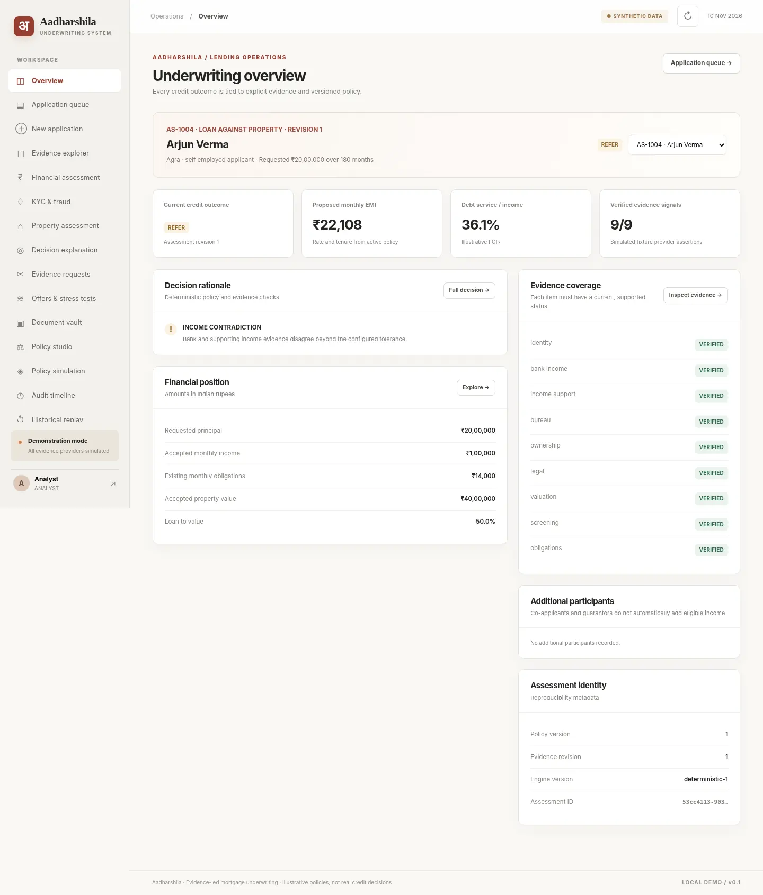
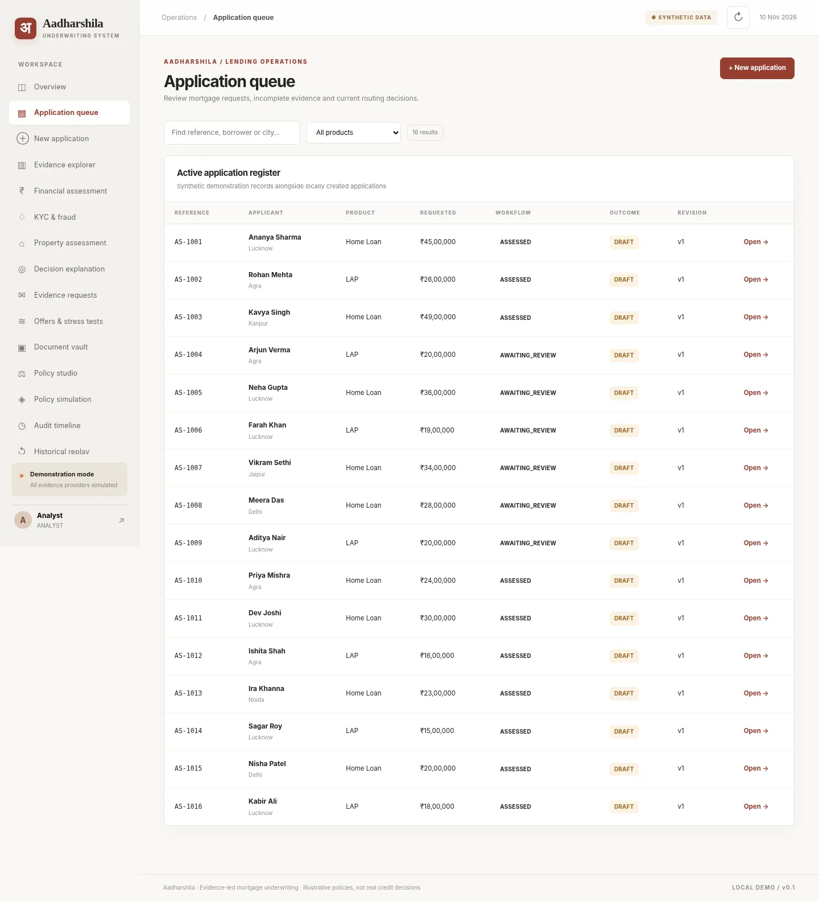
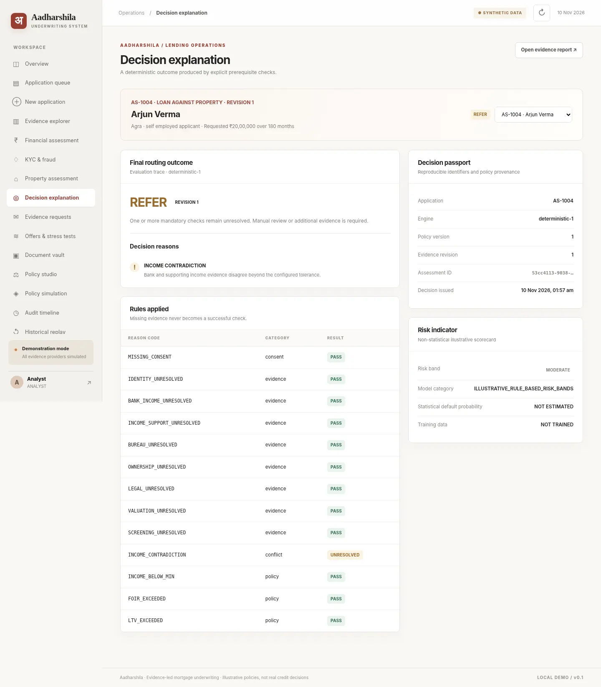
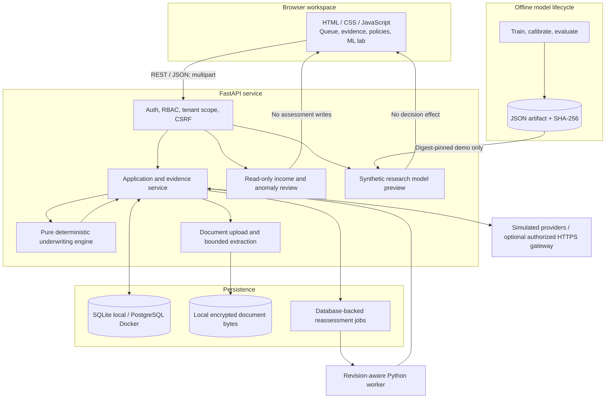
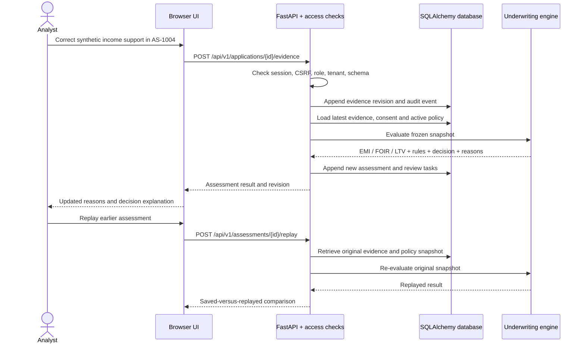
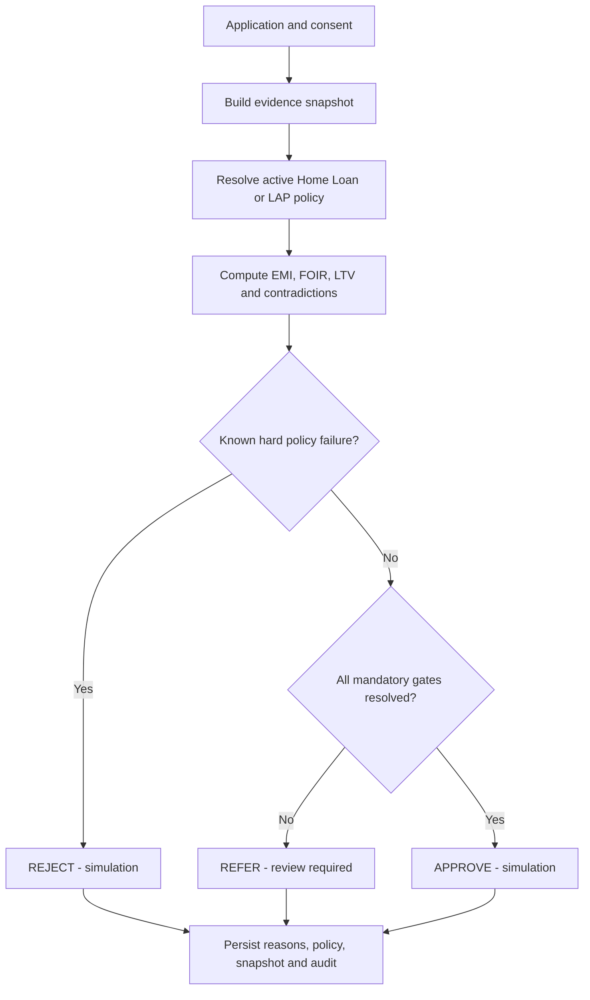
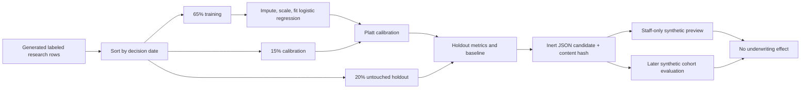

# Aadharshila

<p align="center">
  
</p>

<p align="center"><strong>Mortgage decisions that can show their work.</strong></p>

<p align="center">
  <a href="#the-as-1004-case-in-four-steps">Follow one case</a> ·
  <a href="#3-system-architecture-and-data-pipeline">Inspect the system</a> ·
  <a href="#8-local-setup-and-verification">Run locally</a> ·
  <a href="#7-implemented-now-and-next">See what's built</a>
</p>

<p align="center">
  <a href="https://github.com/pushkkal0201-bit/AadharShila/actions/workflows/quality.yml"></a>
  <a href="pyproject.toml"></a>
  <a href="data/MANIFEST.md"></a>
</p>

Aadharshila is a local underwriting workspace for Home Loans and Loans Against Property. It records the application and supporting evidence, calculates EMI/FOIR/LTV, and applies a versioned credit policy. The output is an explainable `APPROVE`, `REFER` or `REJECT` **simulation**, with a saved snapshot you can still inspect after an analyst changes the file.

Built for the **Housing Fintech Challenge — Digitally Automated Mortgage Underwriting Engine (Problem Statement 2)**, the repo includes 16 synthetic cases, a transaction-anomaly reviewer, and a separate credit-risk research lab.

> [!IMPORTANT]
> **This is not a lending service.** Borrowers, evidence providers and policy thresholds in the demo are synthetic or illustrative. A simulated `APPROVE` is not a sanction. ML outputs cannot approve, reject, refer, price or disburse a loan. No official KYC, credit-bureau, Account Aggregator, property-record or disbursement integration is live.

<table>
<tr>
<td width="25%"><a href="#the-as-1004-case-in-four-steps"><strong>01 / A case</strong></a><br/><sub>Conflicting income → documented referral</sub></td>
<td width="25%"><a href="#2-what-is-different"><strong>02 / Design</strong></a><br/><sub>Evidence revisions and replay</sub></td>
<td width="25%"><a href="#3-system-architecture-and-data-pipeline"><strong>03 / Architecture</strong></a><br/><sub>Request, rules and persistence</sub></td>
<td width="25%"><a href="#8-local-setup-and-verification"><strong>04 / Reproduce</strong></a><br/><sub>Setup, tests and ML laboratory</sub></td>
</tr>
</table>

### The AS-1004 case in four steps

<p align="center">
  
</p>

What's useful here isn't the `REFER` badge. It's the chain of evidence behind it. With income support at ₹55,000 against ₹1,00,000 in bank evidence, the **45% disagreement exceeds the 15% illustrative tolerance**. Correct the synthetic support figure to ₹99,000 and Aadharshila creates a new assessment. The old one remains reproducible. The new result may still be `REFER` if another requirement is unresolved.

<details>
<summary><strong>Open the six-minute judge walkthrough</strong></summary>

1. Sign in as the local **Credit analyst** and open `AS-1004`.
2. Compare the two income assertions in **Evidence explorer**.
3. In **Decision explanation**, find `INCOME_CONTRADICTION` and the rule that triggered it.
4. Open **Evidence intelligence · ML**, load the synthetic transactions and run the read-only anomaly review.
5. Correct the supporting income through the synthetic analyst workflow and reassess.
6. Open **Historical replay**. Verify that the original decision still uses the original evidence and policy.

[Full demonstration runbook](docs/hackathon/DEMO_RUNBOOK.md) · [Windows test checklist](docs/TESTING_WINDOWS.md)

</details>

### The actual workspace

<p align="center">
  <a href="docs/overview.webp"></a>
</p>

<details>
<summary><strong>See the application queue and decision explanation screens</strong></summary>

<p align="center">
  <a href="docs/queue.webp"></a>
  <a href="docs/decision.webp"></a>
</p>

These are screenshots of the running local demo, not mockups of a live lender connection.

</details>

<details>
<summary><strong>What can you interact with in this README?</strong></summary>

The navigation links jump to specific sections, screenshots open in full, these panels expand on click, and the Mermaid diagrams below render on GitHub. The SVG motion is decorative and respects reduced-motion settings. GitHub does not run arbitrary JavaScript or the underwriting app inside a README; the live interface starts only after [local setup](#8-local-setup-and-verification).

</details>

## 1. Why Aadharshila exists

EMI is the easy part. The harder question is whether the inputs can be trusted. A borrower may pass an affordability check while a bank statement disagrees with salary support, a property-title review remains pending, or a bureau request fails. A spreadsheet can give you a number; it usually cannot tell the next analyst **why that number belonged in the decision**.

Take the synthetic **AS-1004** case. The applicant requests a ₹20 lakh Loan Against Property. Bank-income evidence reports ₹1,00,000 per month; supporting income reports ₹55,000. The discrepancy is **45%**, above the demonstration policy's **15% tolerance**. The financial ratios alone do not resolve that contradiction. Aadharshila returns `REFER`, records `INCOME_CONTRADICTION`, and identifies the outstanding review. An analyst can correct synthetic supporting evidence, obtain a fresh assessment, and still replay the old one from the evidence and policy that existed at that moment.

The product handles the operational sequence around that decision:

- **Capture:** application terms, applicant category, participants, purpose-specific consent, and source evidence.
- **Normalize:** reconciled six-month income and accepted, provenance-aware financial inputs; exclude duplicative or non-income credits.
- **Evaluate:** EMI, FOIR, LTV, mandatory identity/bureau/property/legal/screening gates, source conflicts, and a versioned policy.
- **Route:** deterministic `APPROVE`, `REFER`, or `REJECT` **simulation** with exact reason codes and follow-up tasks.
- **Preserve:** immutable-in-practice saved assessment snapshots, revision history, policy context, audit records, and historical replay. The underlying store is not claimed to be legally immutable.

The system is deliberately conservative about missing facts. A provider timeout is **not** successful verification, a PDF parse is **not** proof of authenticity, and a model anomaly is **not** a fraud verdict.

### Decision semantics

| Outcome | Meaning in this repository | Typical trigger |
| --- | --- | --- |
| `APPROVE` | All required *synthetic* evidence gates and illustrative policy conditions pass | `AS-1001` clean Home Loan |
| `REFER` | No known hard failure, but one or more checks need human review or an authorized source | `AS-1004` income contradiction; `AS-1007` provider failure |
| `REJECT` | A known hard illustrative policy condition fails; another missing check cannot hide it | `AS-1003` affordability failure |

The checked-in policy files contain **illustrative assumptions**, not Hero Housing Finance policies or universal RBI thresholds:

| Demonstration term | Home Loan | Loan Against Property |
| --- | ---: | ---: |
| Annual interest rate | 8.5% | 10.5% |
| Maximum FOIR | 50% | 45% |
| Maximum LTV | 80% | 65% |
| Minimum monthly verified income | ₹20,000 | ₹30,000 |
| Maximum tenure | 360 months | 240 months |
| Income mismatch tolerance | 15% | 15% |
| Property value mismatch tolerance | 20% | 20% |

The formulas and precedence rules are specified in [Decision rules](docs/DECISION_RULES.md), with their actual implementation in [`finance.py`](src/aadharshila/finance.py) and [`engine.py`](src/aadharshila/engine.py).

## 2. What is different

An easy way to lose trust in a lending workflow is to overwrite yesterday's evidence with today's correction. The outcome stays in the database, but its explanation becomes impossible to reconstruct. Aadharshila treats **each evidence revision as part of the history**. It freezes the inputs, policy version, executed checks and reasons with the assessment. A correction creates a new assessment; replay reads the old snapshot instead of asking a provider for whatever answer it has today.

A few practical consequences follow:

| Instead of… | Aadharshila does… | Where to inspect it |
| --- | --- | --- |
| Calculating eligibility from whichever number looks largest | Accepts only permitted evidence and checks income-source contradictions; six-month reconciliation cannot increase verified income | [`income.py`](src/aadharshila/income.py), [`engine.py`](src/aadharshila/engine.py) |
| Treating a missing provider response as a null that accidentally passes | Emits an unresolved provider/technical gate and routes for review | [`connectors.py`](src/aadharshila/connectors.py), [`engine.py`](src/aadharshila/engine.py) |
| Displaying an unexplained risk badge | Stores executed rules, reason codes, evidence revisions, and repeatable policy context | [`service.py`](src/aadharshila/service.py), [`docs/ARCHITECTURE.md`](docs/ARCHITECTURE.md) |
| Promoting a policy edit straight into live assessments | Requires validation, impact simulation, separate author/approver action, and a fingerprinted revision | [`compliance_controls.py`](src/aadharshila/compliance_controls.py) |
| Allowing ML to override a credit gate | Runs anomaly review and synthetic risk research in separate, non-decisional paths | [`evidence_intelligence.py`](src/aadharshila/evidence_intelligence.py), [`risk_serving.py`](src/aadharshila/risk_serving.py) |
| Calling any extracted document field "verified" | Separates extraction, origin, verification, expiry, consent, and source mode | [`secure_documents.py`](src/aadharshila/secure_documents.py), [`service.py`](src/aadharshila/service.py) |

### Threshold and provenance hardening

Affordability checks now compare the **unrounded** EMI burden and principal-to-collateral amounts against policy limits. The four-decimal FOIR/LTV shown in the UI is a display value, not the value used to decide whether a limit was exceeded. Negative financial obligations fail validation, and optional obligation evidence must carry authenticated live provenance when the service operates in restricted production mode.

The risk-training pipeline rejects non-numeric values masquerading as missing data, feature values outside its documented **[0, 5]** research contract, and borrower identifiers duplicated after whitespace normalization. Offline external-cohort evaluation applies the same numeric and identifier checks. These are input-validation fixes; they do **not** improve or validate the model's predictive accuracy.

Runtime safeguards also share one deployment-mode boundary. Only explicit `development` and `test` modes allow local demonstration features; `production`, `staging`, and other environment names use restricted behavior. Research preview and local password login remain unavailable in restricted environments. See [decision rules](docs/DECISION_RULES.md) and [ML research protocol](docs/hackathon/FULL_ML_PIPELINE.md).

### Two ML components, two different jobs

**1. Evidence intelligence — analyst triage.** Six-month income reconciliation first excludes duplicate referenced receipts, loan proceeds, and other ineligible transactions. An `IsolationForest` then flags unusual normalized monthly receipt magnitudes relative to a **fixed generated reference distribution**. The visible result includes source comparisons, anomalies, plain-language review actions, and `assessment_effect: NONE`. In the demo, one synthetic monthly receipt jumps to ₹8,20,000. That is a reason to inspect the source, not a finding of fraud.

**2. Risk model laboratory — research, not underwriting.** A calibrated logistic-regression workflow trains on invented 12-month outcome labels with a chronological **65% train / 15% calibration / 20% holdout** split. It produces discrimination/calibration metrics, a constant-prevalence baseline, SHA-256-pinned inert JSON artifacts, additive log-odds contributions, range warnings, and PSI drift diagnostics. A separate later-dated **synthetic** evaluation cohort exercises the offline validation pipeline. The model is expressly disabled for production serving and is not imported by the loan decision engine. Results **cannot** substantiate real mortgage-default accuracy.

**The useful integration point is human judgment:** the ML screen tells an analyst *where to look*; the underwriting engine tells them *which evidence and policy condition prevents the case from progressing*.

For details, read [AI evidence review](docs/hackathon/AI_EVIDENCE_REVIEW.md), [ML pipeline](docs/hackathon/FULL_ML_PIPELINE.md), and [independent-date evaluation](docs/hackathon/INDEPENDENT_MODEL_VALIDATION.md).

## 3. System architecture and data pipeline

The frontend is a browser client. It calls versioned **HTTP REST endpoints with JSON** (and multipart upload for documents); the FastAPI server owns authorization, validation, persistence, and all decisions. Browser authentication uses a local cookie-backed session in the demo and CSRF protection on state-changing requests. An optional institution-configured OIDC authorization-code/PKCE path is implemented but requires an approved identity provider. No gRPC, Kafka, WebSocket, or LLM agent is in the shipped architecture.

### System overview



**Trust boundaries matter more than the diagram's arrows.** The `SIMULATED` fixtures are suitable for testing, not for a lender to rely on. The optional partner-gateway adapter constrains HTTPS hosts and checks signed responses and invocation provenance; it does not mean any named government, banking, or bureau provider has granted access. The document vault uses AES-256-GCM for newly uploaded bytes when configured, but key custody and a fully isolated parser are separate operational requirements.

### One change to one applicant's evidence



A production evidence update must have authenticated, consented provenance. For this demonstration, analysts can edit explicitly labeled synthetic fixtures only. The replay path does **not** call an external provider again.

### Decision precedence



`identity`, `bank_income`, `income_support`, `bureau`, `ownership`, `legal`, `valuation`, and `screening` are required evidence categories. Active financial-underwriting consent is another gate. A potential screening match opens review; it does not become a confirmed accusation. A hard FOIR or LTV failure takes precedence over unrelated incomplete checks. See [the full precedence contract](docs/DECISION_RULES.md).

### Research lifecycle (entirely separate from decisions)



The latest-dated holdout never feeds parameter fitting. The offline external-cohort evaluator enforces its manifest and temporal checks; a declaration that data is authorized cannot itself prove legal permission, borrower separation, or independent validation.

### Important API routes

| Method and route | Purpose |
| --- | --- |
| `GET /health/live` / `GET /health/ready` | Process and database health |
| `POST /api/v1/auth/login` | Development login |
| `GET /api/v1/applications` | Tenant/role-scoped queue |
| `POST /api/v1/applications/{id}/evidence` | Save permitted evidence revision |
| `POST /api/v1/applications/{id}/assessments` | Run deterministic assessment |
| `GET /api/v1/assessments/{id}/explanation` | Executed checks and decision reasons |
| `POST /api/v1/assessments/{id}/replay` | Re-evaluate saved historical snapshot |
| `POST /api/v1/applications/{id}/evidence-intelligence` | Advisory anomaly and reconciliation report |
| `GET /api/v1/research/risk-model/status` | Pinned synthetic model status |
| `POST /api/v1/research/risk-model/preview` | Read-only research prediction |
| `POST /api/v1/research/risk-model/drift` | Descriptive feature PSI |
| `POST /api/v1/policies/{id}/simulate` | Policy-change impact comparison |
| `GET /api/v1/operations/readiness` | Institutional prerequisite diagnostics |

The API reference is served locally at `/docs`. Routes requiring login enforce authorization and, for cookie-backed mutations, CSRF; they are not anonymous public endpoints. Domain entities and job consistency rules are covered in [Architecture](docs/ARCHITECTURE.md).

## 4. Technology and why it is here

The stack is intentionally small enough to inspect. No frontend framework is needed to explain a rule execution, and no heavyweight agent framework is needed to do arithmetic.

| Layer | Technology actually used | Why this choice |
| --- | --- | --- |
| Frontend | HTML5, CSS3, vanilla JavaScript | Keeps the analyst workbench dependency-light; the API remains the only authority for decisions. |
| API | Python 3.11+, FastAPI, Uvicorn | Typed HTTP contracts and straightforward integration with numeric and statistical Python modules. |
| Validation | Pydantic v2 | Rejects malformed or inconsistent payloads before they reach underwriting code. |
| Business math | `decimal.Decimal` | Avoids binary floating-point surprises when producing rupee-denominated EMI and repayment figures. |
| Data access | SQLAlchemy 2 | Maintains consistent tenant-scoped relational access across SQLite and PostgreSQL. |
| Schema changes | Alembic | Schema updates are versioned and repeatable instead of being applied manually to each demo database. |
| Local database | SQLite | One-file persistence makes an offline Windows walkthrough practical. |
| Container database | PostgreSQL 16 | Provides the relational concurrency and recovery foundation for the Docker test environment. |
| ML | scikit-learn, NumPy, pandas | Implements reproducible Isolation Forest, logistic regression, calibration, and tabular evaluation without opaque model services. |
| Model artifact | Inert JSON + SHA-256 | Carries preprocessing and weights as inspectable data and refuses an unpinned artifact; no arbitrary pickle execution. |
| Documents | `pypdf`, optional OCR, `cryptography` | Extracts bounded PDF text and encrypts uploaded bytes with AES-256-GCM when configured; extraction never implies verification. |
| Auth | Local demo sessions; PyJWT / OIDC code + PKCE framework | Supports testable role boundaries now and an integration contract for an approved lender identity provider later. |
| Provider transport | HTTPX, fixed-host HTTPS gateway contract, HMAC checks | Rejects untrusted destinations and unsigned/mismatched provider assertions rather than trusting a status string. |
| Background work | SQLAlchemy-backed reassessment queue and Python worker | Preserves revision-aware, recoverable jobs without deploying a separate message broker for the prototype. |
| Tests | pytest, HTTPX/TestClient, Playwright/Chromium | Checks pure calculations, workflow permissions, API semantics, and real browser interaction. |
| Delivery | Docker Compose, GitHub Actions | Makes PostgreSQL, API, worker, Windows/Ubuntu tests, browser smoke, and recovery checks reproducible. |

This is **not** Next.js, React, Redis, Kafka, Kubernetes, WebSockets, gRPC, a hosted LLM, or an external inference API. Those technologies would be additions, not honest descriptions of the current implementation.

## 5. Scaling to 100,000 active users: a design, not a benchmark

The current build is a **local and CI-tested demonstrator**. It has not supported 100,000 users, nor has it been load-tested at that level. Even “100,000 active users” needs an operational definition: registered accounts, daily active staff, simultaneous sessions, peak request rate, and document/verification load have completely different capacity implications. The plan below assumes an institution-owned, privacy-reviewed multi-tenant service and would require measurement before any deployment.

| Pressure point today | Likely failure mode at scale | Engineering change to evaluate |
| --- | --- | --- |
| Single API process and local runtime | Request contention, restarts interrupting active work | Stateless FastAPI replicas behind a TLS gateway; controlled rolling deploys, readiness probes, measured per-pod concurrency |
| SQLite local demo | Write contention and limited concurrent worker operation | Managed PostgreSQL with correctly sized pools, indexes for tenant/application/revision reads, read replicas only for read-heavy paths |
| Database-backed job polling | Queues and retries compete with transactional underwriting writes | Keep durable application/job state in Postgres; add a broker such as SQS/RabbitMQ/Kafka only after queue-volume and ordering requirements justify it; enforce idempotency |
| Document bytes on local volume | Horizontal replicas cannot share durable files safely | Encrypted object storage, short-lived signed access, retention controls, KMS-backed envelope keys, versioned metadata, and separate isolated parsing workers |
| PDF parsing and optional OCR | CPU/memory spikes and malicious-document exposure | Separate non-root, no-network parser containers with hard CPU/memory/time limits, malware scanning, queue-based ingestion and bounded concurrency |
| External bureau, KYC, AA, registry calls | Partner throttling, unpredictable timeouts, inconsistent retries | Provider-specific quotas, circuit breakers, idempotency keys, backoff, failure taxonomy, request tracing, explicit unresolved states |
| ML evaluation/training on the application host | Offline fitting blocks latency-sensitive requests | Move training and cohort validation into access-controlled batch jobs; pin approved artifacts and keep online inference isolated from loan decisioning |
| Policy revisions and assessment history | Large tenant datasets and concurrent changes | Immutable assessment snapshots, per-tenant indexes/partition planning, optimistic checks, audit retention policy, and replay/load drills |
| Sensitive lending data | One mis-scoped query becomes a privacy incident | Enforce tenant access in APIs and database controls, encryption, least-privilege operators, keyed audit trails, privacy review, and independent penetration tests |

**Capacity methodology, before selecting hardware:** instrument peak request mix and payload sizes; measure p50/p95/p99 for reads, assessments, OCR and provider calls separately; run realistic synthetic-load and fault tests; size Postgres connections per instance; load-test contention on the same application revision; establish recovery point/time objectives; and only then decide replica count and queue technology. A prior 60-request local Linux/SQLite HTTP smoke measured roughly **47.596 ms p95** under that specific synthetic workload. It is not a prediction of throughput, production latency, or mortgage turnaround time.

The current queue has revision-aware idempotency, retries and stale-job supersession. That reduces duplicate work but does not prove exactly-once execution or multi-worker correctness under sustained load. Both require separate stress and recovery tests.

## 6. Constraints and trade-offs

A working hackathon prototype is valuable precisely because the boundaries are visible. Treating fabricated data as externally verified would make the demo look more complete but less defensible.

**Evidence cannot be authenticated by a label.** All checked-in sources use `SIMULATED` provenance. `VERIFIED` in a local fixture means a positive **test assertion**, not a successful KYC or bureau request. The partner gateway implements a bounded integration contract, but no official provider agreement or credential is present.

**There are two models, neither is a production credit scorer.** The anomaly detector learns a fixed synthetic monthly-receipt reference; it may flag legitimate irregular income. The risk laboratory learns synthetic labels that do not measure real repayment behavior. A holdout ROC AUC of about **0.685803**, Brier score **0.137158**, and 300-row later synthetic evaluation demonstrate code execution, **not** credit-worthiness accuracy, fairness, or fraud-detection performance.

**The policy engine is deterministic on purpose.** Fixed logic is inspectable, replayable, and easier to test than a model-driven sanction path. It is also limited by the accuracy of configured policy thresholds and evidence interpretation. Home Loan/LAP values here are illustration only; lender adoption and legal review are not implemented.

**Missing, stale, or failed inputs do not quietly pass.** A required provider failure becomes a review dependency; insufficient income coverage, conflicting documents, or an uncertain screening match can block a simulated approval. Hard financial failure can still produce `REJECT` despite unrelated unresolved items. Source categorization errors and unusual incomes require an analyst rather than blind auto-acceptance.

**Document handling has a defined boundary.** AES-256-GCM protects newly uploaded bytes when appropriately configured, and bounded extraction runs outside the main API process. That subprocess is **not a full security sandbox**: real borrower files would need independent worker isolation, malware scanning, secure keys/retention, issuer authenticity checks, and external testing. Older plaintext development uploads are not automatically migrated.

**Local operations are not production operations.** SQLite, local demo credentials, synthetic seeding, and on-machine document volumes are excellent for a judge's laptop, not a borrower-facing service. Docker/PostgreSQL recovery in CI is a tested development drill, not proof of institutional backup compliance or disaster recovery objectives.

**The remaining external constraints are real.** A lender would need regulated source access, lawful borrower consent, jurisdiction-specific property/legal review, a formally defined default target, matured historical outcomes, borrower-disjoint validation, independent model and security reviews, approved credit rules, protected monitoring, and legal authorization. No binding sanction, loan booking, KFS issuance, or funds movement exists.

## 7. Implemented now and next

### Delivered in the current repository

| Area | Available capability | Reproduce / inspect |
| --- | --- | --- |
| Loan operations | Application queue, new case, Home Loan/LAP assessment, consent, reason codes, review tasks | [`main.py`](src/aadharshila/main.py), [`tests/test_api.py`](tests/test_api.py) |
| Calculations | EMI, FOIR, LTV, alternative loan terms, income/rate/collateral stress tests | [`finance.py`](src/aadharshila/finance.py), [`tests/test_finance.py`](tests/test_finance.py) |
| Evidence integrity | Source mode, expiry, contradictions, versioned evidence, replay and decision diff | [`service.py`](src/aadharshila/service.py), [`tests/test_engine.py`](tests/test_engine.py) |
| Decision boundary hardening | Exact FOIR/LTV policy comparisons, nonnegative amounts and live provenance of optional obligations in production | [`engine.py`](src/aadharshila/engine.py), [`tests/test_engine.py`](tests/test_engine.py) |
| Deployment and ML input controls | Fail-closed environment selection, numeric/feature-range validation and normalized borrower IDs | [`runtime.py`](src/aadharshila/runtime.py), [`risk_training.py`](src/aadharshila/risk_training.py), [`tests/test_environment_boundary.py`](tests/test_environment_boundary.py) |
| Audit and governance | Immutable-in-practice assessment snapshots, policy simulations, separated author/approver actions | [`docs/ARCHITECTURE.md`](docs/ARCHITECTURE.md), [`docs/DECISION_RULES.md`](docs/DECISION_RULES.md) |
| Advisory AI | Isolation Forest receipt anomalies with deterministic reconciliation and analyst actions | [`scripts/hackathon_demo.py`](scripts/hackathon_demo.py), [`tests/test_evidence_intelligence.py`](tests/test_evidence_intelligence.py) |
| ML research | Calibrated logistic regression, chronological split, synthetic inference, SHA-256 artifact registry, PSI drift | [`risk_training.py`](src/aadharshila/risk_training.py), [`tests/test_full_ml_pipeline.py`](tests/test_full_ml_pipeline.py) |
| Independent-date evaluator | Later-dated synthetic cohort, baseline, confidence intervals, calibration and drift | [`risk_external_validation.py`](src/aadharshila/risk_external_validation.py), [`tests/test_risk_external_validation.py`](tests/test_risk_external_validation.py) |
| Protected documents | AES-GCM storage, download checks, bounded PDF extraction and access rules | [`secure_documents.py`](src/aadharshila/secure_documents.py), [`tests/test_encrypted_document_storage.py`](tests/test_encrypted_document_storage.py) |
| Verification | Python suite, Windows/Ubuntu CI, Chromium browser, Docker/Postgres/document recovery | [GitHub Actions](https://github.com/pushkkal0201-bit/AadharShila/actions/workflows/quality.yml) |

The last verified baseline main-branch run at the time of this README update passed **four hosted jobs**: Windows, Ubuntu, Chromium, and Docker/PostgreSQL recovery. The recorded local development checkpoint was **132 passing tests**. These are *software* checks, not validation of real lending efficacy. [Browse current build results](https://github.com/pushkkal0201-bit/AadharShila/actions/workflows/quality.yml).

### Next engineering work, in order

**P0 — Submission:** run the full Windows test suite on the demonstration machine, rehearse `AS-1004` contradiction → revision → replay, record a genuine live-screen walkthrough, and submit the required materials through the organizer's portal. Neither a recorded video nor successful official submission is represented by this repository.

**P1 — Evidence quality:** add testable, confidence-labeled document-field extraction tied to page/field provenance; verify issuer signatures when supported; add source-specific property/legal checklists. None of these may convert OCR text into a trusted provider assertion automatically.

**P1 — Data and model validation:** obtain institution-approved historical origination and *matured* performance records, document label and rejection-bias assumptions, train/evaluate a separately approved candidate, perform independent out-of-time and subgroup audits, and design governance before any real scoring use. US mortgage datasets, if separately licensed, are not drop-in substitutes for Indian Home Loan/LAP records.

**P1 — Authorized provider onboarding:** complete one genuinely contracted integration at a time (identity, bureau, Account Aggregator, property/valuation), including consent, provider response signatures, test fixtures, latency budgets, failure states and legal review.

**P2 — Infrastructure:** isolate document processing, move keys and stored documents to institution-approved services, harden access and monitoring, measure concurrency, establish backed-up PostgreSQL recovery objectives, and carry out an external security review. Only then evaluate horizontal scaling and a dedicated task broker.

The longer institutional prerequisite list is maintained in [Go-live controls](docs/INSTITUTIONAL_GO_LIVE.md) and the [engineering status register](docs/PROJECT_STATUS_2026-11-10.md). This roadmap describes work **not yet done**; it is not a disguised feature list.

## 8. Local setup and verification

For the new boundary regressions, run `.venv\\Scripts\\python.exe -m pytest -q tests/test_engine.py tests/test_finance.py tests/test_environment_boundary.py tests/test_full_ml_pipeline.py tests/test_risk_external_validation.py` on Windows after `setup.bat`. The full `test.bat` still covers the whole repository. These are engineering tests against synthetic or isolated fixtures, not real mortgage validation.


### Prerequisites

- Git and **Python 3.11+**. The CI matrix currently runs Python 3.12 on Windows and Ubuntu.
- Windows 10/11 with CMD and PowerShell, or a Linux/macOS shell.
- Optional: Docker + Compose for PostgreSQL, Node.js for a JavaScript syntax check, Playwright/Chromium for browser smoke tests.
- An internet connection for the initial Python dependency installation. No paid AI API key is required for the synthetic ML demonstrations.

### Windows: existing checkout (recommended)

```bat
cd /d D:\Projects\AadharShila
git pull --ff-only origin main
if not exist .venv\Scripts\python.exe py -3.11 -m venv .venv
setup.bat
test.bat
run.bat
```

`setup.bat` now installs **`requirements-ml.txt`**, including pandas, NumPy, and scikit-learn. An earlier local checkout installed only the base requirements and failed ML tests with `No module named 'pandas'`. If that happens, rerun `setup.bat`; **do not delete the database**.

For a fresh clone instead:

```bat
if not exist D:\Projects mkdir D:\Projects
cd /d D:\Projects
git clone https://github.com/pushkkal0201-bit/AadharShila.git
cd AadharShila
py -3.11 -m venv .venv
setup.bat
run.bat
```

Open [http://127.0.0.1:8000](http://127.0.0.1:8000), select **Credit analyst** (`analyst`) and use the explicitly local synthetic demo password **`Demo@12345`**. The development seed has 16 cases. If reassessment jobs are queued, start `worker.bat` in a second CMD window.

**Health checks:**

```bat
curl http://127.0.0.1:8000/health/live
curl http://127.0.0.1:8000/health/ready
```

The expected readiness response is `{"status":"READY","database":"connected"}`; the live API specification is at [http://127.0.0.1:8000/docs](http://127.0.0.1:8000/docs).

### Demonstrate the underwriting path

| Case | What should happen |
| --- | --- |
| `AS-1001` | All synthetic gates pass; simulated `APPROVE` |
| `AS-1003` | Affordability limit breached; `REJECT` |
| `AS-1004` | Income sources disagree; `REFER`, `INCOME_CONTRADICTION` |
| `AS-1006` | Possible screening match remains a review dependency |
| `AS-1007` | Provider failure leaves evidence unresolved |

For `AS-1004`, open **Decision explanation** and **Evidence intelligence · ML**. Change *synthetic* `income_support` from ₹55,000 to ₹99,000 in **Evidence explorer**, reassess, and open **Historical replay** to confirm the original reason is preserved. The new outcome can still be `REFER` if other gates remain open. Do not reset a non-disposable database to restore a demo scenario.

Run the read-only anomaly example without the browser:

```bat
.venv\Scripts\python.exe scripts\hackathon_demo.py
```

Check that the output reports the income contradiction and unusual monthly receipt, and that `read_only` is true and `credit_decision_modified` is false.

### Start the separate research model laboratory

Stop an existing `run.bat` with Ctrl+C first, because both launchers use port 8000:

```bat
ml_demo.bat
```

Then open **Risk model laboratory**. Select a synthetic lower- or higher-stress preset, acknowledge the disclaimer, and run research inference. The UI shows the pinned model hash, calibration/holdout summary, synthetic-label score, and log-odds feature contributions. No application is modified.

The separate later-date synthetic evaluation runs as:

```bat
.venv\Scripts\python.exe -m aadharshila.risk_validation_demo --artifact .risk-ci\research_model.json --output-dir .risk-ci\independent --rows 300 --seed 99
notepad .risk-ci\independent\independent_evaluation.json
```

The report must retain `model_activated: false` and `independent_validation_completed: false`. See [the external-evaluation contract](docs/hackathon/INDEPENDENT_MODEL_VALIDATION.md) before attempting to use any non-synthetic dataset.

### Linux / macOS development checkout

```bash
git clone https://github.com/pushkkal0201-bit/AadharShila.git
cd AadharShila
python3 -m venv .venv
source .venv/bin/activate
python -m pip install -r requirements-ml.txt
python -m pip install --no-deps -e .
export APP_ENV=development SEED_DEMO=true DATABASE_URL=sqlite:///./aadharshila.db
python -m alembic upgrade head
python -m pytest -q
python -m uvicorn aadharshila.main:app --host 127.0.0.1 --port 8000
```

### Docker/PostgreSQL development checkout

```bash
cp .env.example .env
# Replace SESSION_SECRET in .env with a unique development secret.
docker compose up -d --build --wait
docker compose ps
docker compose logs -f api worker
```

Compose creates PostgreSQL 16, the API, and the worker. Its credentials and localhost binding are designed for **development**. Stop with `docker compose down` (without `-v` if you need your volumes). The repository CI runs [`scripts/docker_backup.sh`](scripts/docker_backup.sh) and [`scripts/docker_restore_drill.sh`](scripts/docker_restore_drill.sh) against disposable synthetic data.

### Environment variables — names and roles

Only the local/demo values in `.env.example` are illustrative. Never commit a filled `.env`, a real borrower record, live provider credentials, or a document encryption key.

| Variable | Used for |
| --- | --- |
| `APP_ENV`, `SEED_DEMO` | Development mode and synthetic fixture loading |
| `DATABASE_URL`, `UPLOAD_DIR` | Database and document storage paths |
| `SESSION_SECRET` | Local/session signing configuration; set a unique secret outside development |
| `AADHARSHILA_DOCUMENT_KEYS_PATH`, `AADHARSHILA_DOCUMENT_ACTIVE_KEY_ID` | Optional configured encryption keyring for uploaded bytes; required for production upload handling |
| `AADHARSHILA_PARTNER_ALLOWED_HOSTS` and provider-scoped `AADHARSHILA_PARTNER_*` | Optional authorized HTTPS provider gateway; not needed for the demo |
| `OIDC_ISSUER`, `OIDC_AUDIENCE`, `OIDC_JWKS_PATH`, `OIDC_CLIENT_ID`, `OIDC_CLIENT_SECRET`, `OIDC_REDIRECT_URI` | Approved enterprise identity-provider integration; not needed for local password login |
| `AADHARSHILA_RESEARCH_MODEL_PATH`, `AADHARSHILA_RESEARCH_MODEL_SHA256` | Synthetic-only, digest-pinned research preview configured by `ml_demo.bat` |
| `METRICS_ACCESS_TOKEN`, `CLAMAV_UNIX_SOCKET` | Optional restricted metrics and production malware-scanning integration |

See [`.env.example`](.env.example) for the supported configuration surface and [provider onboarding](docs/PROVIDER_ONBOARDING.md) for the optional gateway contract.

### Test suite and acceptance evidence

```bash
python -m pytest -q
node --check web/app.js
# Optional full Chromium smoke:
python -m pip install -r requirements-browser.txt
python -m playwright install chromium
python scripts/browser_smoke.py
```

The [GitHub quality workflow](.github/workflows/quality.yml) runs Windows and Ubuntu Python tests, a real Chromium smoke, synthetic ML training plus independent-date evaluation, artifact verification, and a Docker/PostgreSQL document backup/restore drill. **A passing CI run checks code behavior, not real-bank model quality or legal authorization.**

For a step-by-step Windows acceptance checklist see [Windows testing](docs/TESTING_WINDOWS.md); for an explicit inventory of completed work and external dependencies see [Project status](docs/PROJECT_STATUS_2026-11-10.md).

---

**Aadharshila makes a mortgage decision inspectable.** The useful result is not just `REFER`; it is a trace from the evidence available at that revision, through the exact policy and executed controls, to a reason the next analyst can act on — and a record that still explains the decision after the file changes.