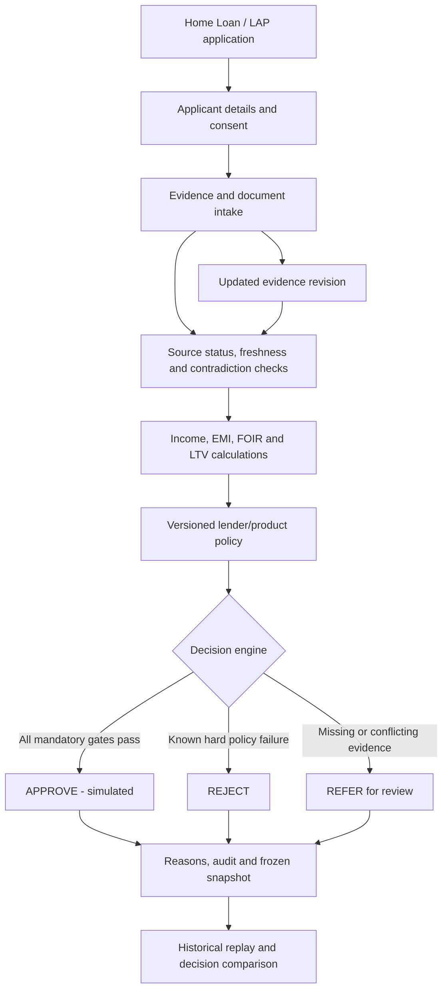
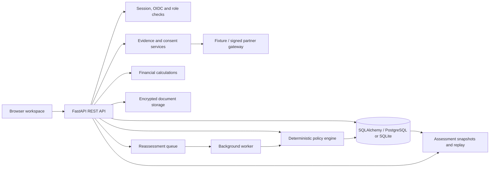

# Aadharshila

**Evidence-led mortgage underwriting for Home Loans and Loans Against Property.**

Aadharshila is a working underwriting demonstrator that connects an applicant's financial position, document evidence, property checks and lender-specific policy into a traceable credit assessment. It explains *why* an application passes, fails or needs human review—and preserves the evidence and rules behind each result.

Built with **FastAPI, SQLAlchemy, PostgreSQL, Python and a browser-based JavaScript workspace**. The repository includes 16 synthetic mortgage cases, a deterministic decision engine, audit and replay tools, role-based workflows, and automated integration checks.

[](https://github.com/pushkkal0201-bit/AadharShila/actions/workflows/quality.yml)

> **Demo scope:** All sample applicants, financial records and provider responses are synthetic. `APPROVE`, `REFER` and `REJECT` are illustrative underwriting outcomes—not real loan sanctions. No licensed credit bureau, KYC provider, lender or disbursement system is connected.

## The problem

A mortgage decision is more than an EMI calculation.

An applicant may show sufficient income on a bank statement, but a tax record may tell a different story. A property valuation can appear reasonable while ownership checks remain incomplete. A credit report can be missing because the provider is unavailable. Those are different problems, and they should produce different actions.

In a fragmented review process, the analyst has to move between documents, worksheets, provider portals and policy manuals. A number may change without a clear record of its source. Reassessment can become difficult to explain, especially after the supporting evidence or credit policy has changed.

**Aadharshila keeps the chain intact:** evidence → calculations → policy checks → reason codes → review outcome → historical record.

## How it works



An assessment runs on a frozen snapshot of the application, evidence and active policy. Every rule records its result. Changing evidence creates a new revision and assessment; it does not erase the earlier decision.

### Decision logic

| Outcome | When the engine returns it | What it means |
| --- | --- | --- |
| **APPROVE** | All applicable evidence and policy gates pass | The *demonstration* checks are satisfied; no lender commitment is issued |
| **REFER** | Required evidence is missing, stale, contradictory or blocked by a provider failure | An analyst must resolve the outstanding issue |
| **REJECT** | A known hard policy limit is breached | The application fails the configured illustrative policy |

A hard policy failure takes precedence over unrelated missing evidence. Missing information never counts as a pass. A provider response marked `SIMULATED` remains simulated even if its fixture verification status reads `VERIFIED`.

### Financial calculations

The engine uses decimal arithmetic for EMI, FOIR, LTV, repayment amounts and affordability limits.

```text
FOIR = (existing monthly obligations + proposed EMI) / accepted monthly income
LTV  = requested loan principal / accepted property valuation
```

Income reconciliation excludes own-account transfers and loan proceeds, checks duplicates and reversals, and highlights statement coverage gaps or unusual volatility. Analyst-entered previews do not automatically become source-verified income. Policy thresholds are configured independently for Home Loans and LAP; the included rates and limits are demonstration assumptions.

## See it in action


*Overview of a synthetic application, its affordability figures, evidence status and decision rationale.*

### Five-minute judge walkthrough

Start the application, select **Credit analyst**, and sign in with the local demo password `Demo@12345`.

| Step | Open | What to demonstrate |
| --- | --- | --- |
| **1 — Inspect** | **Overview → AS-1004** | A self-employed LAP application requesting ₹20,00,000 against a ₹40,00,000 property valuation |
| **2 — Explain** | **Evidence explorer → Decision explanation** | Bank and supporting income values disagree. The engine returns `REFER` with `INCOME_CONTRADICTION`, despite all nine *synthetic* evidence categories showing a verified fixture status |
| **3 — Resolve** | **Evidence explorer** | Correct the supporting synthetic income value to `99000` through the permitted analyst flow. Reassessment produces a new evidence revision; any other unresolved issue still blocks approval |
| **4 — Replay** | **Historical replay → Decision changes → Audit timeline** | Re-run the previous assessment against its *original* evidence and policy snapshot. Compare the old and new reason codes without changing history |
| **5 — Compare** | **Application queue → Policy simulation** | Inspect clean, adverse and unavailable-provider cases; then show how a proposed policy change affects synthetic portfolio outcomes before approval |

For the unmodified **AS-1004** case, the dashboard illustrates:

| Measure | Synthetic example |
| --- | ---: |
| Requested principal | ₹20,00,000 |
| Tenure | 180 months |
| Proposed EMI | ₹22,108 |
| Accepted monthly income | ₹1,00,000 |
| Existing obligations | ₹14,000/month |
| FOIR | 36.1% |
| LTV | 50.0% |
| Decision | **REFER** |
| Reason | `INCOME_CONTRADICTION` |

The figures alone suggest manageable affordability. The contradiction is why this case is referred. That distinction is central to the product.


Other useful seeded cases: **AS-1001** (clean illustrative Home Loan), **AS-1003** (affordability failure), **AS-1006** (potential screening match requiring review) and **AS-1007** (provider failure, not a successful verification). A longer guided sequence is available in [docs/DEMO_SCRIPT.md](docs/DEMO_SCRIPT.md).

## What is implemented

| Area | Current behavior |
| --- | --- |
| **Application intake** | Home Loan and LAP records, applicant roles, ownership, consent, participants and revision history |
| **Evidence verification** | Source/mode labeling, freshness, expiry, conflicting income and valuation signals, provider failures, evidence requests and audit records |
| **Financial assessment** | EMI, FOIR, LTV, monthly surplus, eligibility calculations, alternative terms and stress scenarios |
| **Decision explanation** | Executed policy rules, reason codes, blockers, accepted inputs and reproducible assessment snapshots |
| **Policy governance** | Organization-scoped versions, author/approver separation, recorded impact simulations, approval reasons and activation audit |
| **Document vault** | PDF/TXT uploads, content integrity checks, optional OCR and malware-scanner integration; AES-256-GCM encrypted storage with configured institutional keys and bounded PDF subprocess parsing |
| **Identity and access** | Demo roles, borrower/object ownership checks, CSRF protection, and OIDC authorization-code/PKCE with MFA-claim validation for configured institutional identity providers |
| **Integrations** | Synthetic provider fixtures, consent-aware adapters and an authenticated, signed partner-gateway contract; no live financial-provider access |
| **Credit-risk research** | Reproducible synthetic outcome generation, an offline interpretable model-training pipeline, chronological holdout metrics and feature-drift diagnostics |
| **Operations** | Database migrations, reassessment worker, health checks, metrics, backup/recovery scripts and CI across Windows, Ubuntu, Chromium and PostgreSQL |

### Where AI fits

The decision shown in the workspace is **deterministic and explainable**. A favorable predictive score cannot override missing identity, legal, property or consent requirements.

The repository also contains an **offline credit-risk research pipeline**: it trains an interpretable logistic-regression model, evaluates chronological holdout data and records calibration-related metrics. Its included evaluation uses generated records and invented outcomes. **There is no validated real-mortgage probability-of-default model in the live decision engine.** OCR and document extraction support evidence review but do not authenticate document issuers.

## Architecture



The backend is a modular monolith. FastAPI handles request validation and access control. SQLAlchemy persists applications, policies, evidence revisions, assessments and audit events. Alembic manages schema changes. The worker handles queued reassessments with input-revision checks to avoid committing obsolete jobs.

```text
AadharShila/
├── src/aadharshila/
│   ├── main.py                 # REST API, authorization and workflow endpoints
│   ├── service.py              # Assessment persistence, revisioning and replay
│   ├── engine.py               # Policy evaluation and decision reasons
│   ├── finance.py              # EMI, FOIR, LTV and scenario calculations
│   ├── income.py               # Transaction and income reconciliation
│   ├── connectors.py           # Consent-aware provider gateway contracts
│   ├── secure_documents.py     # Authenticated encrypted document storage
│   ├── document_isolation.py   # Bounded PDF extraction process
│   ├── browser_sso.py          # OIDC/PKCE login and session handling
│   ├── risk_training.py        # Offline model evaluation
│   └── worker.py               # Revision-aware background jobs
├── web/                        # Browser workspace (HTML, CSS, JavaScript)
├── policies/                   # Illustrative Home Loan / LAP JSON policies
├── migrations/versions/        # Versioned database migrations
├── tests/                      # Functional, access-control and regression tests
├── scripts/                    # Browser/HTTP tests, restore drills and Windows scripts
├── infra/                      # Production-style configuration example
├── docs/                       # Architecture, decision rules, operations and evidence
└── docker-compose.yml          # Local PostgreSQL + API + worker
```

**Stack:** Python · FastAPI · Pydantic v2 · SQLAlchemy 2 · Alembic · PostgreSQL 16 / SQLite · vanilla JavaScript · Playwright · pytest · Docker Compose · GitHub Actions. Optional research dependencies include scikit-learn; optional document processing uses Tesseract/PDFium and ClamAV when configured.

## Run locally

### Windows (Python 3.11 or 3.12)

Python **3.12** is used in GitHub CI; **3.11** is supported for local development. If you have multiple Python versions installed, create `.venv` with your selected interpreter *before* running `setup.bat`.

**New installation — Command Prompt:**

```bat
if not exist D:\Projects mkdir D:\Projects
cd /d D:\Projects
git clone https://github.com/pushkkal0201-bit/AadharShila.git
cd AadharShila
py -3.11 -m venv .venv
setup.bat
run.bat
```

**Existing checkout — Command Prompt:** Stop the running API first, then:

```bat
cd /d D:\Projects\AadharShila
git pull --ff-only origin main
setup.bat
run.bat
```

Open **http://127.0.0.1:8000**. Select **Credit analyst** and enter the demo password `Demo@12345`. In a second CMD window, run `worker.bat` for queued reassessments. Run `test.bat` to execute the Python suite.

### Linux / macOS

```bash
git clone https://github.com/pushkkal0201-bit/AadharShila.git
cd AadharShila
python3 -m venv .venv
source .venv/bin/activate
python -m pip install -r requirements.txt
python -m pip install --no-deps -e .
export APP_ENV=development SEED_DEMO=true
export DATABASE_URL=sqlite:///./aadharshila.db
python -m alembic upgrade head
python -m uvicorn aadharshila.main:app --host 127.0.0.1 --port 8000
```

### Docker with PostgreSQL

```bash
cp .env.example .env
# Set a unique, non-demo SESSION_SECRET in .env before starting.
docker compose up --build -d --wait
docker compose ps
```

The development stack starts the API, PostgreSQL and a reassessment worker. Stop it with `docker compose down` to retain its volumes.

### Useful endpoints

| Endpoint | Purpose |
| --- | --- |
| `http://127.0.0.1:8000/` | Analyst/borrower workspace |
| `http://127.0.0.1:8000/docs` | Interactive OpenAPI explorer |
| `GET /health/live` | Process health |
| `GET /health/ready` | Database readiness |
| `GET /api/v1/applications` | Authorized application queue |
| `POST /api/v1/applications/{id}/assessments` | Reassess against current permissible evidence |
| `GET /api/v1/assessments/{id}/explanation` | Executed rules and reason codes |
| `POST /api/v1/assessments/{id}/replay` | Reproduce an earlier assessment |

```bash
curl -sS http://127.0.0.1:8000/health/ready
# {"status":"READY","database":"connected"}
```

## Testing and evidence

The engineering release recorded **109 passing local automated tests**. Its hosted GitHub Actions run also passed Windows and Ubuntu tests, a Chromium browser smoke and a PostgreSQL/document recovery drill. The CI badge above reflects subsequent runs as they complete.

```bash
python -m pytest -q
node --check web/app.js

# Optional: browser smoke
python -m pip install -r requirements-browser.txt
python -m playwright install chromium
python scripts/browser_smoke.py

# Optional: bounded HTTP workload against a local synthetic dataset
python scripts/http_benchmark.py --requests 60 --concurrency 6

# Optional: reproducible synthetic risk research
python -m pip install -r requirements-ml.txt
python -m aadharshila.synthetic_risk_benchmark --output-dir .risk-ci --seed 42 --rows 640
```

A recorded local HTTP smoke completed 60/60 authenticated requests with approximately **47.6 ms p95** under its stated synthetic workload. It is not a production benchmark. Similarly, reported model metrics describe synthetic labels and are not evidence of real-world credit prediction quality.

- [CI verification for the engineering release](https://github.com/pushkkal0201-bit/AadharShila/actions/runs/42780517502)
- [Decision rules and formulas](docs/DECISION_RULES.md)
- [Architecture and data flow](docs/ARCHITECTURE.md)
- [Security boundaries](docs/SECURITY_REVIEW.md)
- [Reproducible credit-risk research](docs/RISK_TRAINING.md)
- [Operations and recovery](docs/OPERATIONS.md)

## Configuration

Use `.env.example` for the Docker development stack. The Windows scripts use local SQLite defaults unless environment variables are already set.

| Variable | Meaning |
| --- | --- |
| `APP_ENV` | `development` or `production`; production applies stricter safety checks |
| `DATABASE_URL` | SQLite for single-machine development; PostgreSQL for the Docker stack |
| `SEED_DEMO` | Enables 16 deterministic synthetic applications on initial development startup |
| `SESSION_SECRET` | Session-signing secret; replace the development value before any shared deployment |
| `UPLOAD_DIR` | Document storage location |
| `AADHARSHILA_DOCUMENT_KEYS_PATH` | External AES-256-GCM document keyring path |
| `AADHARSHILA_DOCUMENT_ACTIVE_KEY_ID` | Active key identifier for new encrypted uploads |
| `ENABLE_DOCUMENT_OCR` | Enables optional OCR dependencies when installed |
| `CLAMAV_UNIX_SOCKET` | Malware scanning service; unavailable production scanning blocks uploads |
| `OIDC_*` | Institutional identity provider, client, pinned keys and callback configuration |
| `AADHARSHILA_PARTNER_*` | Approved signed provider-gateway endpoints and credentials |
| `AADHARSHILA_TRUST_STORE` / `AADHARSHILA_RELEASE_BUNDLE` | Institution-issued governance attestations |
| `METRICS_ACCESS_TOKEN` | Protects the internal HTTP metrics endpoint |

Never commit `.env`, borrower documents, credentials, encryption keys or local database files.

## Demonstration boundaries

**What is present:** an auditable underwriting workflow, explicit decision reasons, historical replay, configurable policies, structured provider contracts, security controls and repeatable synthetic tests.

**What is not authorized or proven:** live CKYCR/DigiLocker, Account Aggregator, credit bureau, GST or property-registry access; validated real-mortgage default prediction; lender-approved credit terms; independently certified production security; binding sanction documents; or disbursement. Document subprocess isolation also requires an OS/container sandbox for actual untrusted borrower files.

The software deliberately blocks real-production approval paths without the institution's release prerequisites. For exact requirements, see [institutional go-live controls](docs/INSTITUTIONAL_GO_LIVE.md) and the [production-readiness matrix](docs/PRODUCTION_READINESS.md).

## Contributing

Branch from `main`. Keep changes scoped to a subsystem and add regression tests for new rules, evidence states, access-control decisions and migrations.

```bash
python -m pip install -r requirements-ml.txt
python -m pip install --no-deps -e .
python -m pytest -q
node --check web/app.js
```

Open a pull request with the behavior changed, migration impact, test results and any new security or regulatory assumptions. Do not rewrite saved assessment history, turn synthetic provider results into live claims, or bypass required review controls.