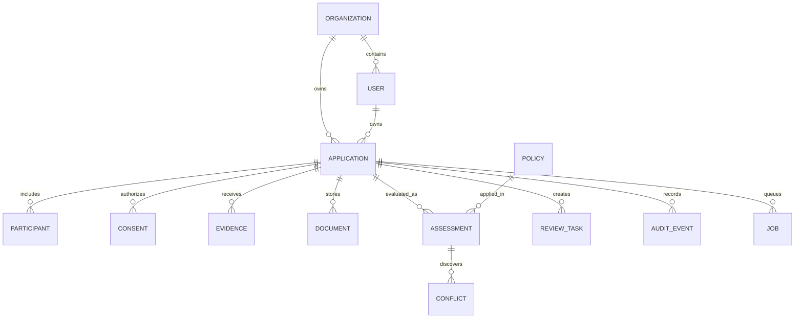

# Architecture and data flow

## Components

The API coordinates intake, consent, evidence, financial calculations, policy, decisioning, review, versioned reports and replay. SQLAlchemy owns persisted business entities and Alembic owns the migration history. The browser calls versioned REST endpoints; no business decision is computed in the browser.

```mermaid
sequenceDiagram
    participant U as Borrower / analyst
    participant API as FastAPI
    participant DB as Persistence
    participant P as Policy engine
    U->>API: Submit application
    API->>DB: Record application, consent and evidence revision
    API->>DB: Read current evidence and active policy
    API->>P: Evaluate frozen input snapshot
    P-->>API: Calculations, controls, conflicts, decision
    API->>DB: Append assessment, tasks, audit event
    API-->>U: Outcome + reasons + assessment ID
    U->>API: Provide corrected evidence
    API->>DB: Increment revision; preserve old assessment
    API->>P: Recompute from new snapshot
    API->>DB: Append new assessment
    U->>API: Replay prior assessment
    API->>P: Evaluate stored inputs and policy (no provider call)
    API-->>U: Field-by-field comparison
```

## Domain ownership

- **Identity / access:** `User` scoped by `Organization`; bearer- or cookie-based sessions and server-side permissions.
- **Application:** persisted requested loan terms, applicant category, participants, workflow, revision and owner.
- **Consent:** purpose, subject, provider, categories, notice version, grant and revocation timestamps.
- **Evidence:** key, structured value, source, mode, verification status, captured time, expiry and revision.
- **Documents:** original bytes, hash, parse status, fields and filename. Parsed is not equivalent to verified.
- **Policy:** named product, effective version, lifecycle and safe fixed-operator thresholds. Policy author cannot self-approve.
- **Assessment:** frozen input/policy/model-band version and computed result. A new revision creates a new row.
- **Operations:** review tasks, conflicts, append-only application-level audit events and durable reassessment jobs.

## Status separation

Application workflow: `DRAFT`, `SUBMITTED`, `ASSESSING`, `ASSESSED`, `AWAITING_REVIEW`.

Evidence verification: `UNRESOLVED`, `VERIFIED`, `FAILED`; also `expired` derived from persisted expiry timestamps.

Credit outcome: `APPROVE`, `REJECT`, `REFER`.

Policy state: `DRAFT`, `VALIDATED`, `APPROVED`, `ACTIVE`, `RETIRED`.

Background job: `QUEUED`, `RUNNING`, `COMPLETED`, `FAILED`, `SUPERSEDED`. Jobs are idempotent by application + target revision + kind; worker checks revision before committing.

## Consistency design

The normal local intake/revision path reassesses synchronously. An explicit queued-reassessment API places a durable row in `jobs`. The worker claims jobs atomically, retries failed jobs at most three times, reclaims stale `RUNNING` work after 60 seconds and refuses to evaluate an obsolete target revision. At-least-once semantics are intended; exactly-once execution is **not** promised. Horizontal multi-worker correctness and long-duration outage handling need load testing.

## Data movement and trust

Borrower claims and PDF text remain **unverified** unless a permitted, independently established source supports a check. Only staff may record an explicitly simulated fixture as verified for local demonstrations; self-reported evidence cannot become verified through this API. Evidence snapshots contain verification state and expiry result. Missing prerequisite facts never become passing conditions by omission.

## Entity relationship summary



This is a **local engineering demonstrator**, not the target regulator's final data architecture. Additional independently verifiable facts, full evidence dependencies and formal data retention classes are recorded in the production-readiness matrix.
