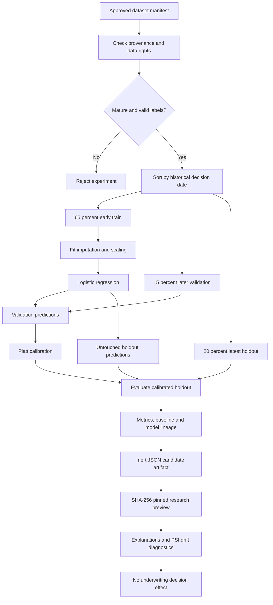

# Mortgage ML research pipeline — implementation and validation boundary

Aadharshila has **two separate ML components**. The existing `evidence_intelligence.py` uses an Isolation Forest to flag anomalous six-month transaction patterns. The model implemented in this stage is a **calibrated logistic-regression research workflow for a synthetically generated 12-month outcome**. Its prediction does not influence an application, acceptance, price, eligibility, or rejection.

This is an end-to-end **software/model-engineering implementation**, not a validated lending probability-of-default model. No real historical lender outcomes or authorized credit-bureau/AA data are supplied. Real-world accuracy, discrimination, fairness, approval performance, adoption, and financial benefit cannot be inferred from invented labels.

## Model lifecycle



The chronological partition prevents random shuffle leakage. The pipeline refuses duplicate borrower identifiers, invalid dates, repeated decision dates at partition boundaries, missing binary labels, non-finite predictors, inadequate class counts, and—when `synthetic=false`—outcomes that have not completed the declared 12-month observation window. Only six explicit decision-time numeric features are accepted. Unknown and outcome fields cannot be silently added to the model.

### Features and transformations

| Feature | Interpretation in this research exercise |
| --- | --- |
| `foir` | Proposed and existing debt service relative to accepted income |
| `ltv` | Proposed principal relative to accepted collateral value |
| `monthly_surplus_ratio` | Income after obligations and EMI, relative to accepted income |
| `obligation_to_income_ratio` | Existing debt obligations relative to income |
| `income_volatility` | Historical fluctuation indicator, computed only from permissible decision-time data |
| `credit_utilization` | Pre-decision utilization indicator, if an authorized source supplies it |

Before any fitting, both the development dataset and the later external-cohort evaluator reject non-numeric strings masquerading as missing features, observed research-feature values outside the **[0, 5]** contract, and duplicate borrower IDs after trimming whitespace. Genuine missing numeric features can still be handled through the documented imputation protocol. These checks protect data contracts and split integrity; they do not establish source authenticity, fair-lending compliance or statistical validity.

Median imputation and standard scaling are fitted **only on the training period**; the same transformations are carried into later evaluation. A logistic model produces initial scores, and a separate Platt sigmoid is trained on later validation observations. The final, newest holdout is used only to compute evaluation metrics. The code also records a constant training-prevalence baseline, log loss, ROC AUC, average precision, Brier score, expected calibration error and reliability bins. The validation calibration metrics are in-sample for the calibrator; only the holdout evaluation is independently held out.

Each artifact is an inert JSON file with feature ordering, preprocessing values, coefficients, calibration parameters, distribution quantiles, PSI reference bins, dataset and manifest digests, a versioned schema, and a model-parameter fingerprint. It is not a pickle, TorchScript, executable model bundle or arbitrary Python object. A hash is an **integrity check**, not a cryptographic attestation that a training dataset is licensed or approved.

## Run on Windows (D: drive)

Existing local Aadharshila installation:

```bat
cd /d D:\Projects\AadharShila
git pull --ff-only origin main
setup.bat
ml_demo.bat
```

`ml_demo.bat` installs the optional `requirements-ml.txt`, generates 640 artificial records using seed 42, trains the research model, computes and pins its SHA-256 digest for the current server process, and launches the same FastAPI app. Stop a separately running `run.bat` first to free port 8000.

Open `http://127.0.0.1:8000`, select **Credit analyst**, use the local demo password, and open **Risk model laboratory**. The form includes six synthetic feature inputs, lower- and higher-stress presets, and an explicit synthetic-data acknowledgement. It shows the score for the **invented outcome label**, calibrated and uncalibrated values, log-odds feature contributions, data-range warnings and the artifact digest. No selected mortgage application's state is read or modified.

## Run manually (Linux / macOS / Windows virtual environment)

```bash
python -m pip install -r requirements-ml.txt
python -m pip install --no-deps -e .
python -m aadharshila.synthetic_risk_benchmark --output-dir .risk-ci --seed 42 --rows 640
python -m aadharshila.risk_registry add \
    --artifact .risk-ci/research_model.json --registry .risk-ci/registry
```

Use `python -m aadharshila.risk_registry verify --entry .risk-ci/registry/<sha256>` to verify the immutable research candidate. Both the artifact and registry directory must stay out of public source commits when derived from anything except synthetic data.

On Linux/macOS, configure a separate **development-only** server:

```bash
export APP_ENV=development
export AADHARSHILA_RESEARCH_MODEL_PATH="$PWD/.risk-ci/research_model.json"
export AADHARSHILA_RESEARCH_MODEL_SHA256="$(sha256sum "$AADHARSHILA_RESEARCH_MODEL_PATH" | cut -d' ' -f1)"
python -m uvicorn aadharshila.main:app --host 127.0.0.1 --port 8000
```

A SHA-256 digest must be set explicitly. If it is wrong, the artifact is missing, the JSON schema is invalid, a non-synthetic artifact is provided, or the environment is `production`, the research preview fails closed.

## Research API contract

Authenticated staff only. POST calls require the application's CSRF handling for cookie-backed sessions.

```text
GET  /api/v1/research/risk-model/status
POST /api/v1/research/risk-model/preview
POST /api/v1/research/risk-model/drift
```

Example `preview` JSON body (synthetic observations only):

```json
{
  "synthetic_acknowledged": true,
  "features": {
    "foir": 0.36,
    "ltv": 0.50,
    "monthly_surplus_ratio": 0.55,
    "obligation_to_income_ratio": 0.10,
    "income_volatility": 0.20,
    "credit_utilization": 0.25
  }
}
```

The response includes `research_score`, `uncalibrated_score`, `contributions`, `distribution_warnings`, `artifact_sha256`, `decision_use: false`, `assessment_effect: "NONE"`, and an explicit warning about the artificial labels. The value is **not an operational default probability**. Contributions represent additive associations on the model's log-odds scale; they are not causal explanations or grounds for adverse credit action.

`drift` accepts 100–2,000 synthetic rows with exactly those six numeric fields and the acknowledgement flag. It compares incoming counts against training-set quantile bins and returns per-feature PSI with no automatic score threshold, promotion, retraining, or application mutation. PSI alone says nothing about fairness, default accuracy or permissible source use.

### Research outputs to report to judges

The fixed-seed 640-record generator produces a temporal holdout of 128 invented outcomes. In the local environment used to develop this stage, the calibrated model produced approximately **ROC AUC 0.685803** and **Brier score 0.137158**; a constant training-prevalence baseline produced Brier **0.139880**. These results apply only to this statistical generator and are **not mortgage-risk validation results**. Rerun the command to generate your environment's exact report. Do not report these numbers without the synthetic label qualifier.

## Safeguards and independent verification

- Role checks: borrowers cannot access research endpoints. No model artifact can be submitted by an API caller.
- No implicit data binding: the research form does not read an applicant, bank statement, bureau record or loan outcome from the database.
- Deployment block: research API endpoints are unavailable when `APP_ENV=production`.
- Source/data controls: non-synthetic artifacts, missing digests, digest mismatches and invalid feature schema are refused.
- Evaluation: test labels do not influence fitting, transformations or calibration. A regression test changes only holdout labels and proves the parameters are unchanged.
- Registry: an immutable content-addressed entry records research status, dataset/manifest fingerprints and a digest. The registry is not an authorization system.
- Feature safety: the API requires every feature, checks finite bounded inputs, and displays training-range warnings. It has no decision threshold.
- Model limitations: there is no independent real-world validation, no labeled fairness/subgroup audit, and no lender-approved monitoring protocol.

Run `python -m pytest tests/test_full_ml_pipeline.py -q` to exercise these boundaries. Hosted GitHub CI also exercises the full Python suite on Windows and Ubuntu and the browser smoke on Chromium.

## Source map

| File | Responsibility |
| --- | --- |
| [`risk_training.py`](../../src/aadharshila/risk_training.py) | Input validation, temporal partitions, preprocessing, fitting, Platt calibration, holdout metrics and JSON artifact |
| [`synthetic_risk_benchmark.py`](../../src/aadharshila/synthetic_risk_benchmark.py) | Fixed-seed invented data and labels, reproducibility test fixture |
| [`risk_registry.py`](../../src/aadharshila/risk_registry.py) | Immutable research candidate archive and digest checks |
| [`risk_serving.py`](../../src/aadharshila/risk_serving.py) | Operator-pinned, synthetic-only loading, preview and drift |
| [`risk_monitor.py`](../../src/aadharshila/risk_monitor.py) | Descriptive PSI computation |
| [`main.py`](../../src/aadharshila/main.py) | Staff authorization, CSRF and research endpoints |
| [`web/app.js`](../../web/app.js) | Synthetic feature form, status, score and contribution visualizations |
| [`tests/test_full_ml_pipeline.py`](../../tests/test_full_ml_pipeline.py) | Leakage, research-only policy, integrity and API regression tests |

## Real mortgage model prerequisites

A real lending model needs a lender-controlled dataset with lawful usage rights and complete 12-month observation windows, a documented default definition and rejection/selection-bias review, representative out-of-time samples, calibration and cohort stability evaluation, subgroup/fair-lending assessment, independent validation, governance sign-off, an approved model registry and serving policy, monitoring runbooks, retraining thresholds, and a defined human escalation process. A trained classifier alone does not establish any of these controls.

Aadharshila's actual underwriting outcomes remain in [`engine.py`](../../src/aadharshila/engine.py); **no research model is imported into or used by that engine**.
